# DeepSeek-V4.1-Flash: KV 캐시 압축의 한계를 넓히다

DeepSeek-AI · research@deepseek.com

원문: arXiv:2609.19969v1 [cs.CL], 2026년 9월 17일

이 문서는 사용자가 제공한 PDF의 한국어 번역본이다. 본문과 부록의 설명, 그림·표의 제목과 주석을 번역했으며, 모델명·벤치마크명·서지정보와 저자명은 원문 표기를 유지했다. 그림과 수식의 원본 표기는 보존했다. 본문에 표시한 원문 쪽수로 원본과 대조할 수 있다. 원문의 주장은 저자의 서술을 그대로 옮긴 것이다.

## 초록

장시간에 걸쳐 작업을 수행하는 에이전트가 널리 도입되면서 모델 워크로드에서 입력이 차지하는 비중이 점점 커지고 있다. 기존 연구가 긴 문맥 연산 비용을 상당히 줄였음에도, 프리필은 여전히 많은 계산을 요구하며 대규모 KV 캐시는 HBM과 SSD의 용량 및 데이터 전송 대역폭에 계속 부담을 준다. 이러한 연산·저장·대역폭 수요는 배포 비용을 더 낮추는 데 가장 큰 병목이 된다. 이 문제를 해결하기 위해, 백본 파라미터 5,520억 개와 최대 100만 토큰의 문맥을 지원하는 멀티모달 전문가 혼합(Mixture-of-Experts, MoE) 모델인 DeepSeek-V4.1-Flash를 제안한다. 인과적 인코더-디코더(Causal Encoder-Decoder, CED) 구조 덕분에 이 모델은 디코딩 시 토큰당 160억 개의 파라미터를 활성화하지만, 프리필 시에는 80억 개만 활성화하여 에이전트 워크로드의 비용 효율성을 크게 높인다.

KV 캐시 압축의 한계를 넓히기 위해 DeepSeek-V4.1-Flash는 압축 희소 어텐션 2(Compressed Sparse Attention 2, CSA2)의 계층 간 KV 캐시 재사용과 FP4 KV 캐싱을 결합한다. 이 설계로 전역 KV 캐시(항상 HBM에 상주)의 크기를 토큰당 890바이트, 즉 DeepSeek-V4-Flash의 약 1/4로 줄였다. 또한 SWA 제한 재실행(SWA Bounded Replay)이라는 전용 배포 최적화로, 영속 KV 캐시(항상 SSD 또는 호스트 메모리에 보관)의 크기를 DeepSeek-V4-Flash의 약 1/8로 줄였다. KV 캐시가 훨씬 작아졌음에도 모델은 기준 모델보다 상당히 나은 성능을 보인다. 아울러 DeepSeek-V4 구조를 단순화하고 여러 효율적인 구조적 확장을 도입했다. 45조 토큰으로 구성된 멀티모달 코퍼스로 사전학습하고 포괄적인 사후학습을 수행하여, 다양한 텍스트 및 멀티모달 에이전트 상황에서 높은 성능을 달성했다. 모델 체크포인트는 https://huggingface.co/deepseek-ai/DeepSeek-V4.1-Flash 에 공개되어 있다.

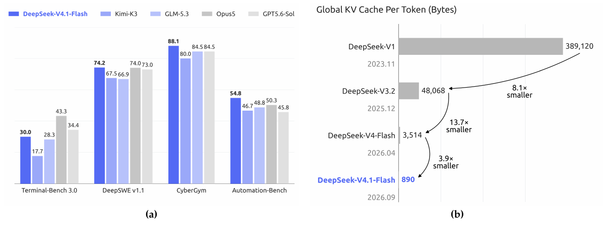

**그림 1.** (a) 에이전트 벤치마크에서 DeepSeek-V4.1-Flash와 비교 모델의 성능. (b) DeepSeek 모델 세대별 토큰당 전역 KV 캐시 크기(바이트). 문맥 메모리 요구량을 줄이기 위한 지속적인 노력을 보여 준다. DeepSeek-V4.1-Flash의 토큰당 전역 KV 캐시는 DeepSeek-V4-Flash 대비 약 4배, DeepSeek-V1 대비 약 437배 작다. 그림의 ‘Global KV Cache Per Token (Bytes)’는 ‘토큰당 전역 KV 캐시(바이트)’, ‘smaller’는 ‘더 작음’을 뜻한다.

## 목차

1. 서론 (원문 4쪽)

2. 구조 (7쪽): 개요, 멀티모달 구조, CED, CSA2, 효율적인 구조적 확장, 최적화

3. 공통 인프라 (16쪽): 학습 인프라, 추론 시스템

4. 사전학습 (20쪽): 데이터 구축, 사전학습 설정, 평가

5. 사후학습 (25쪽): 사후학습 파이프라인, 비동기 사후학습 인프라, 평가

6. 결론, 한계 및 향후 방향 (37쪽)

참고문헌 (38쪽)

부록 A. 저자 목록 (46쪽)

부록 B. 평가 세부사항 (47쪽)

부록 C. 추론 노력 제어의 지수형 토큰 페널티 (49쪽)

## 1. 서론

*원문 4쪽*

최근 장기 작업 에이전트의 응용이 빠르게 확대되면서, 초장문 문맥 처리가 점점 중요한 모델 워크로드가 되었다. 이러한 워크로드를 지원하려면 긴 시퀀스를 효율적으로 처리할 뿐 아니라, 대규모 KV 캐시를 영속적으로 저장하고 재사용하며 전송할 수 있어야 한다. 따라서 KV 캐시 관리는 모델 배포의 기반 기능이 되었지만, 동시에 연산·저장·통신 전반에 상당한 과제를 안겨 주었다. 희소 어텐션 분야의 선행 연구(DeepSeek-AI, 2025, 2026b)는 긴 시퀀스 처리의 연산 비용을 크게 줄였고, 그 결과 영속 저장과 데이터 이동이 점점 더 두드러진 병목으로 떠올랐다.

구체적으로 DeepSeek-V4(DeepSeek-AI, 2026b)는 전체 문맥을 포괄하는 전역 어텐션 분기와 국소 슬라이딩 윈도 어텐션(Sliding-Window Attention, SWA)을 결합한다. 전역 분기는 주 KV(main KV)와 인덱서 K로 구성된 전역 KV를 유지하고, SWA는 국소 KV 상태를 유지한다. 윈도 크기가 고정되어 있으면 SWA KV의 저장량은 시퀀스 길이와 무관하게 제한된다. 따라서 시퀀스가 충분히 길어지면 전역 KV가 실행 중 KV 메모리 사용량의 대부분을 차지하며, 이는 HBM 용량의 제약을 받는다. 또한 일부 KV는 접두부 재사용을 위해 영속적으로 저장된다. 이를 영속 KV 캐시라고 부르며, SSD와 호스트 메모리 용량의 제약을 받는다. I/O 및 상호연결 대역폭도 캐시 이동과 적재를 제한한다. 이러한 제약은 서비스 처리량을 제한하고 배포 비용을 높여, 결국 더 긴 작업 기간과 더 넓은 응용 상황에 에이전트를 도입하고 활용하는 것을 어렵게 한다.

따라서 저장 및 통신 병목을 완화하고 긴 문맥 서비스 비용을 낮추려면 KV 캐시 크기를 더 줄이는 것이 중요하다. 이를 위해 더 적극적인 KV 캐시 압축을 목표로 하는 멀티모달 MoE 모델 DeepSeek-V4.1-Flash를 개발했다. 이 모델은 백본 파라미터 5,520억 개를 가지며, 멀티모달 입력을 기본적으로 지원하고 최대 100만 토큰의 문맥을 수용한다. 디코더의 전역 KV를 마지막 인코더 은닉 상태에서 투영하는 CED 구조를 채택했다. 이에 따라 프리필 시 토큰당 80억 개, 디코딩 시 160억 개의 파라미터를 활성화하며, 이는 입력 비중이 높은 에이전트 상황에서 특히 비용 효율적이다. DeepSeek-V4-Flash보다 상당히 큰 모델임에도, 같은 시퀀스 길이에서 실행 중 KV 캐시 저장량은 약 1/4, 영속 KV 캐시 저장량은 약 1/8에 불과하다. 또한 전반적인 성능도 더 뛰어나다.

이러한 압축 수준은 모델 구조, 캐시 정밀도, 배포 전략을 함께 최적화하여 달성했다. 개념적으로 DeepSeek-V4는 압축된 전역 문맥을 보강한 SWA 기반의 국소 처리 백본으로 볼 수 있다. 이 관점에 따라 국소 어텐션 설계는 대부분 유지하면서 전역 분기를 단순화하는 데 집중했다. 구조 차원에서는 전역 KV(주 KV와 인덱서 K 포함) 및 Top-K 인덱스를 계층 간 재사용하여 KV 캐시 저장량을 크게 줄이는 CSA2를 설계했다. CSA2에는 정적으로 할당되는 세 가지 모드인 Full, Reindex, Reuse가 있다. Full 모드는 전역 KV를 생성하고 인덱싱을 수행한다. Reindex 모드는 이전 계층의 전역 KV를 재사용하되 자체 인덱서 Q로 공유된 인덱서 K의 점수를 다시 계산하여 새로운 Top-K 인덱스를 선택한다. Reuse 모드는 이전 계층의 전역 KV와 Top-K 인덱스를 모두 재사용하여 희소 어텐션을 바로 수행한다. 세 모드 모두 각 계층의 전역 Q와 SWA KV는 따로 유지한다. 전역 KV와 인덱서 K를 공유하면 중복 캐시 저장이 줄어든다. 또한 CSA와 고압축 어텐션(Heavily Compressed Attention, HCA)을 혼합하는 DeepSeek-V4와 달리, DeepSeek-V4.1-Flash는 CSA2만 사용한다. 캐시 정밀도 측면에서는 학습 중 FP4 전역 KV 캐시를 사용하면서도 성능 저하를 미미한 수준으로 유지했다.

*원문 5쪽*

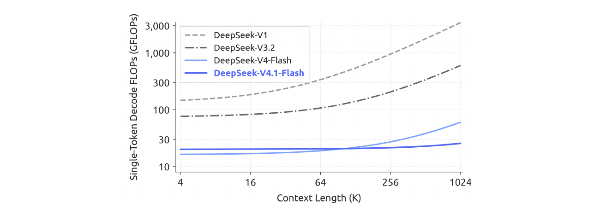

**그림 2.** DeepSeek 모델 세대별 문맥 길이에 따른 단일 토큰 디코딩 FLOPs. 연산 정밀도를 고려하기 위해 BF16, FP8, FP4 연산에 각각 1, 0.5, 0.25의 가중치를 적용했다. DeepSeek-V4.1-Flash는 문맥이 길어져도 디코딩 FLOPs가 거의 일정하여, 긴 문맥 상황의 연산 비용을 크게 줄인다. Context length는 ‘문맥 길이’, Decode FLOPs는 ‘디코딩 부동소수점 연산 수’를 뜻한다.

CSA2와 FP4 KV 캐싱을 함께 적용하면 그림 1(b)처럼 전역 KV 캐시 저장량이 DeepSeek-V4-Flash의 약 1/4로 줄어든다. 배포 차원에서 DeepSeek-V4.1-Flash는 DeepSeek-V4와 마찬가지로 모든 계층에 SWA를 사용한다. DeepSeek-V4에서는 SWA KV 캐시를 영속 저장하는 비용과 정확히 재구성하는 연산 비용 사이의 균형을 맞추기 위해 혼합 전략을 사용했다. 정확한 재구성을 위해서는 최근 L × n_win개의 토큰을 재실행해야 한다. 여기서 L은 계층 수, n_win은 SWA 윈도 크기다. DeepSeek-V4.1-Flash에서는 최근 n_win개의 토큰만 재실행하여 필요한 SWA KV 상태를 근사적으로 재구성하는 SWA 제한 재실행을 도입했다. 실험 결과 성능 저하는 무시할 만큼 작았다. 이 결과는 저장과 연산 사이의 새로운 절충점을 제시한다. 즉, 약간의 프리필 재계산을 감수하면 SWA KV 캐시를 SSD에 영속 저장하지 않아도 된다. 이에 따라 영속 KV 캐시 크기는 DeepSeek-V4-Flash의 약 1/8까지 줄어든다. 이들 최적화는 HBM 및 SSD 용량 부담을 크게 완화하고 배포 비용을 낮춰 더 큰 규모의 배포를 가능하게 한다.

CED와 CSA2에 더해 기존 DeepSeek-V4 구조를 추가로 단순화했다. 기존 mHC(Xie et al., 2026)를 Single-Pass mHC로 개선했으며, 이에 대응하는 Mega-mHC 배포 커널은 원래의 네 커널 구현에 비해 활성값 메모리 트래픽을 절반으로 줄인다. 또한 Engram(Cheng et al., 2026b) 조건부 메모리 모듈을 통합하여 모델 역량을 강화했다. 반자기회귀 초안 생성과 신뢰도에 따른 검증 스케줄링을 통해 디코딩 효율을 높이는 DSpark(Cheng et al., 2026a) 추측 디코딩 구조도 도입했다. 모든 구조 개선을 결합한 결과, 단일 토큰 디코딩 FLOPs는 문맥 길이가 달라져도 거의 일정하다. 그림 2에서 문맥 길이를 4K에서 1M으로 256배 늘려도 디코딩 FLOPs는 1/4만 증가하며, 이는 DeepSeek-V4-Flash의 증가 폭보다 훨씬 작다.

이러한 구조의 KV 캐시 압축 효과를 충분히 실현하고 학습 및 추론 효율을 더 높이기 위해, 학습 인프라와 추론 시스템을 체계적으로 공동 최적화했다. 이를 통해 대규모 멀티모달 학습과 긴 문맥 배포의 효율성 및 확장성을 확보했다. 학습 인프라는 비전 인코더의 분리 실행, 긴 시퀀스를 위한 균형 잡힌 이미지 샤딩, 어텐션 재사용을 위한 파이프라인 단계 간 공유 상태 관리를 지원한다. 추론 시스템은 인코더와 디코더의 SWA 제한 재실행 경로를 구현한다.

*원문 6쪽*

추가 최적화에는 통신과 연산의 중첩, Engram 임베딩 테이블의 샤딩, 추론 커널 융합이 포함된다. 특히 CSA2 Reuse 모드의 각 계층은 프리필에서 15개, 디코딩에서 11개의 커널만으로 실행된다. 호스트 메모리에서는 오래 유지되는 전역 KV와 수명이 짧은 인코더 SWA KV를 분리해 저장하고, 누락된 인코더 SWA 상태를 제한 재실행으로 근사 복원한다.

사전학습에서는 45조 토큰으로 구성된 대규모 멀티모달 코퍼스를 사용했다. 밀집 어텐션 워밍업 단계를 거치지 않고, 시퀀스 길이 64K에서 희소 어텐션을 처음부터 학습했다. 사전학습 후 모델은 멀티모달 역량을 기본적으로 갖추고 최대 100만 토큰의 문맥을 지원한다. 평가에서 DeepSeek-V4.1-Flash-Base는 전체 파라미터의 1/3, 활성화 파라미터의 1/4만 사용하면서도 DeepSeek-V4-Pro-Base에 견줄 만한 세상 지식, 추론, 코딩 역량을 보였고, 학습에 사용하지 않은 평가에서 5%~10%의 향상을 달성했다. 이는 높은 파라미터 효율성과 실제 배포를 위한 학습 데이터 품질의 개선을 보여 준다.

이 기본 모델을 바탕으로 추론 및 에이전트 역량을 이끌어 내기 위한 사후학습을 수행했다. 앞서 설명한 구조적 혁신과 달리 사후학습에서는 새로운 알고리즘을 도입하지 않았다. 지도 미세조정(SFT), 강화학습(RL), 온폴리시 증류(OPD)로 이어지는 표준 방식을 따랐으며, DeepSeek-V4 개발(DeepSeek-AI, 2026b)에 쓰인 확립된 관행을 넘어서는 수정은 하지 않았다. 실질적인 변화는 모두 데이터 파이프라인에 있다. 데이터 합성과 환경 구축을 위한 대규모 자동화 파이프라인을 개발하고, RL에 쓰이는 데이터·과제·롤아웃의 규모를 점진적으로 늘려 텍스트, 멀티모달, 에이전트 영역 전반의 역량을 확장했다. 그림 1(a)는 주요 에이전트 벤치마크 성능을 요약한다. 평가에 따르면 작은 활성화 규모에도 불구하고 이 모델은 다음과 같은 특징을 보인다.

- **추론.** 수학과 경쟁 프로그래밍처럼 집중적인 추론이 필요한 벤치마크에서 높은 정확도를 유지하며, Kimi-K3(Team et al., 2026a)와 DeepSeek-V4-Pro 등 최상위 공개 모델에 견줄 만한 성능을 보인다.
- **에이전트.** Terminal-Bench 2.1(Merrill et al., 2026), DeepSWE v1.1(DataCurve, 2026), AutomationBench(Shepard and Salimans, 2026) 등의 표준 에이전트 벤치마크에서 비공개 최첨단 모델과 대등한 성능을 달성한다. 일상적인 코딩 과제와 사무 업무를 충분히 처리할 수 있음을 보여 주었다. 다만 전문가 수준의 도메인 지식을 요구하는 Terminal-Bench 4.0(Marten et al., 2026a) 같은 과학 중심 에이전트 과제에서는 초대형 모델과의 격차가 남아 있다.
- **멀티모달.** 시각적 추론과 전문 차트 해석을 평가하는 벤치마크에서는 Kimi-K3 같은 최상위 공개 경쟁 모델을 능가한다. 정형화된 지표를 넘어, 렌더링한 화면 캡처로 시각적 점검과 자기수정을 수행하는 프런트엔드 개발 및 사무 자동화 같은 실제 시각 에이전트 작업에서도 실용성을 보인다. 그러나 초대형 비공개 시스템과 비교하면 전반적인 성능 차이는 여전히 뚜렷하다.

이 결과는 DeepSeek-V4.1-Flash가 이미 대다수 벤치마크에서 비공개 최첨단 모델과 대등하고, 실제 과제의 95% 이상을 완수할 수 있음을 나타낸다. 한편 작은 활성화 규모는 낮은 추론 지연과 서비스 비용으로 이어진다. 따라서 우리는 이 모델이 역량과 효율 사이에서 유리한 절충점을 제공하며, 폭넓은 사용자의 일상 업무를 지원하는 빠르고 저렴한 도우미가 될 수 있다고 본다.

*원문 7쪽*

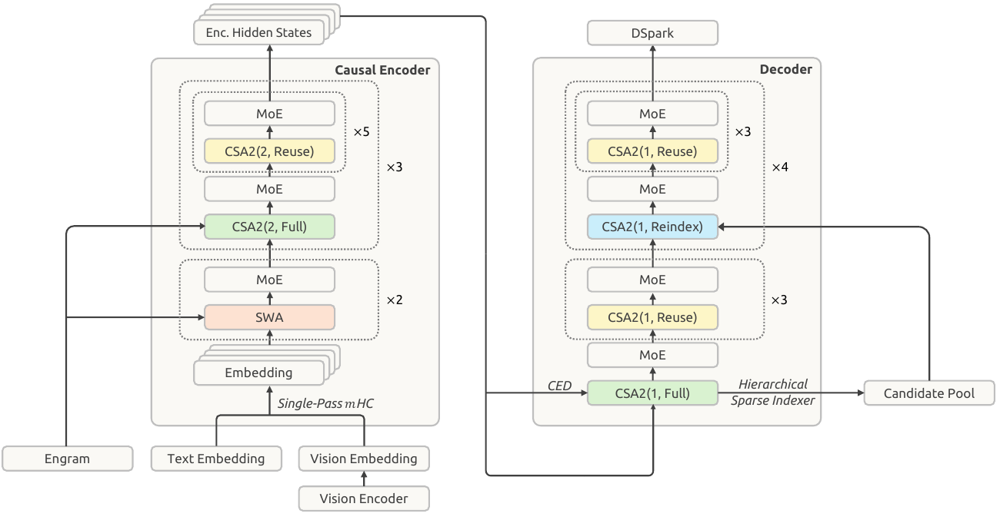

**그림 3. DeepSeek-V4.1-Flash의 전체 구조.** 40개 계층의 네트워크는 각각 20개 계층으로 구성된 인과적 인코더와 디코더로 나뉜다. 모든 피드포워드 계층은 표준 DeepSeekMoE를 사용한다. 인코더의 처음 두 계층은 SWA를, 나머지는 CSA2를 사용한다. CSA2(ratio, mode)는 압축비와 모드를 나타낸다. Single-Pass mHC, Engram, DSpark 및 계층적 희소 인덱서도 사용한다. 도식의 Causal Encoder는 ‘인과적 인코더’, Decoder는 ‘디코더’, Vision Encoder는 ‘비전 인코더’, Embedding은 ‘임베딩’, Enc. Hidden States는 ‘인코더 은닉 상태’, Candidate Pool은 ‘후보 풀’을 뜻한다.

종합하면 DeepSeek-V4.1-Flash는 모델 지능과 추론 효율을 동시에 개선하면서 배포 비용을 낮춘다. 장기 작업 에이전트를 대규모로 배포하는 데 따르는 비용 장벽을 크게 낮추고, 더 다양한 상황에서의 활용 가능성을 연다. 또한 이후의 지속적인 규모 확장을 위한 새로운 출발점이 된다. 우리는 이 기반 위에서 모델 구조·사전학습·사후학습의 규모를 함께 확장하여 모델 지능의 한계를 계속 탐구할 것이다.

## 2. 구조

### 2.1. 개요

DeepSeek-V4.1-Flash는 이미지와 텍스트를 입력받아 텍스트를 자기회귀적으로 생성하는 멀티모달 MoE 트랜스포머다. 언어 백본은 40개 인과적 트랜스포머 계층으로 구성되며, 앞의 20개는 인과적 인코더, 뒤의 20개는 디코더를 이룬다. SWA만 사용하는 첫 두 계층을 제외하면, 각 계층은 전역 어텐션과 SWA를 모두 포함한다. 비전 인코더와 MLP 투영기는 이미지를 시각 임베딩으로 변환하며, 언어 모델 사전학습 시작부터 멀티모달 데이터를 사용하여 시각 임베딩과 텍스트 임베딩을 함께 처리한다. 전체적으로 백본 파라미터는 5,520억 개, Engram 파라미터는 1,960억 개다. 토큰당 활성화 파라미터는 프리필에서 80억 개, 디코딩에서 160억 개다. 전체 구조는 그림 3에 제시했다.

*원문 8쪽*

CED와 CSA2는 긴 문맥 추론에서 서로 보완적인 비용 문제를 해결한다. CED는 인코더 출력으로 디코더의 전역 KV 캐시를 구성하므로, 계층별 국소 SWA를 유지하면서도 대부분의 프롬프트 토큰이 디코더 전체 연산을 건너뛸 수 있다. 이에 따라 프리필 연산이 거의 절반으로 줄고, 문맥이 계속 늘어나는 에이전트 워크로드에서 새 입력이나 캐시에 없는 입력의 처리 비용이 낮아진다. CSA2는 전역 KV를 계층 간 공유하여 캐시 저장량을 줄이고, 희소 선택 결과를 재사용하여 인덱싱 작업을 줄인다. 디코더의 계층적 희소 인덱서는 앞선 인덱서가 고른 후보 풀 안에서 이후 인덱서가 검색하도록 제한하여, 쿼리마다 점수를 계산해야 하는 항목 수를 더 줄인다.

DeepSeekMoE(Dai et al., 2024)의 공유 전문가와 세분화된 라우팅 전문가를 유지하고, 이미지와 텍스트 토큰을 위한 모달리티별 부하 분산(Wang et al., 2024a)을 도입했다. Single-Pass mHC(Xie et al., 2026)는 잔차 스트림 혼합을 수정하여 커널 융합을 효율화하고, Engram(Cheng et al., 2026b)은 희소하게 접근하는 조건부 메모리를 추가한다. 백본 사전학습에서는 MTP 모듈을 생략하고 추측 디코딩에 DSpark(Cheng et al., 2026a)를 사용한다. DSpark는 백본 사전학습이 끝난 후 별도로 학습한다. 또한 주 KV 캐시를 FP4로 압축하여 저장 오버헤드를 더 줄인다. 다음 절에서는 각 구성 요소와 이에 대응하는 최적화 변경을 설명한다.

#### 2.1.1. 멀티모달 구조

멀티모달 입력 경로는 비전 인코더와 MLP 투영기로 구성된다. 각 입력 이미지에 대해 비전 인코더는 공간 격자 형태의 시각 특징을 생성한다. 이후 3 × 3 픽셀 언셔플(pixel-unshuffle) 연산으로 각 국소 영역을 채널 차원으로 재배열하여 공간 해상도를 낮춘다. 그런 다음 MLP 투영기가 특징을 언어 백본의 은닉 차원으로 매핑한다. 최종 시각 임베딩은 입력 임베딩 시퀀스의 해당 이미지 토큰 위치에 삽입되어, 텍스트 임베딩과 함께 언어 백본에서 처리된다.

**DeepSeek-ViT.** 다양한 해상도의 이미지를 기본적으로 처리하도록 DeepSeek-ViT라는 비전 인코더를 처음부터 학습했다. Vision Transformer(Dosovitskiy et al., 2021)를 바탕으로 몇 가지를 수정했다. 임의 해상도의 입력을 수용하기 위해 표준 절대 위치 임베딩을 2D-RoPE로 교체했다. ViT를 LLM의 설계 원칙에 더 가깝게 맞추기 위해 패치 임베딩 계층의 합성곱을 선형 투영으로 바꾸어 Muon 옵티마이저와의 호환성을 확보했다. 정규화에는 RMSNorm(Zhang and Sennrich, 2019), 활성화 함수에는 SwiGLU(Shazeer, 2020)를 사용했다. 시각 특징을 LLM에 넣기 전에 3 × 3 다운샘플링을 하는 픽셀 언셔플을 적용해 시각 토큰 수를 1/9로 줄이며, 최대 약 1344 × 1344픽셀의 입력 해상도를 효과적으로 지원한다.

**MoE를 위한 멀티모달 보조 손실 없는 부하 분산.** 이미지 토큰과 텍스트 토큰은 표현 분포가 서로 달라 MoE에서 선호하는 전문가 라우팅도 다를 수 있다. 둘을 합친 전체 부하만 균형화하면 모달리티별 불균형이 가려질 수 있다. 이를 해결하기 위해 보조 손실 없는 부하 분산(Wang et al., 2024a)을 확장하여 텍스트와 이미지 토큰용 전문가별 보정 편향을 각각 유지한다. 라우팅할 때 각 토큰은 자기 모달리티에 해당하는 보정 편향으로 전문가를 선택하되, 선택한 전문가 출력을 가중하는 데에는 원래의 라우팅 점수를 사용한다. 각 학습 단계 이후 두 편향 집합을 각각의 전문가 부하에 따라 독립적으로 갱신한다. 이 설계는 각 모달리티 안에서 전문가 활용을 균형화하고 안정적이며 효율적인 멀티모달 학습에 기여한다.

### 2.2. 인과적 인코더-디코더(CED)

*원문 9쪽*

에이전트 워크플로에서는 잦은 도구 호출로 다량의 프리필 요청이 발생하며, KV 캐시 미스가 나면 심각한 연산 오버헤드가 생긴다. 이러한 프리필 병목을 완화하기 위해 YOCO(Sun et al., 2024)에서 영감을 얻은 CED 구조를 제안한다. YOCO는 위쪽 절반의 계층이 아래쪽 절반에서 생성한 KV 캐시를 직접 공유하게 하여 프리필 연산을 줄인다. CED는 이 개념을 바탕으로 일련의 구조 개선을 도입해 전체 KV 캐시의 용량과 KV 생성의 연산 깊이를 모두 높인다. 그 결과 기준 모델과 비슷한 성능을 유지하면서 프리필 연산을 거의 절반으로 줄인다.

전역 어텐션에서는 트랜스포머 아래쪽 L/2개 계층을 인과적 인코더로 취급한다. 위쪽 절반, 즉 디코더(l > L/2)의 KV 항목은 각 계층의 은닉 상태 H_l에서 만들지 않는다. 대신 계층별 투영 가중치 W_l^KV와 W_l^Z를 사용해 (L/2)번째 계층의 은닉 상태 H_(L/2)에서 직접 투영한다.

$$C_l=H_{L/2}W_l^{KV},\quad Z_l=H_{L/2}W_l^Z,\quad l>L/2\qquad(1)$$

여기서 C와 Z는 각각 KV 항목과 그에 대응하는 압축 가중치다. 이 설계 덕분에 프리필 단계에서 앞쪽 절반의 계층만 계산하고도 적은 비용으로 위쪽 계층의 전역 KV 캐시를 얻을 수 있다.

SWA에서는 모든 계층에 걸쳐 기존의 계층별 연산을 유지한다. 구체적으로 어떤 계층 l에서도 국소 키와 값은 해당 계층의 은닉 상태 H_l에서 직접 나온다. 이는 국소 KV 생성의 연산 깊이를 실질적으로 늘린다. 그러나 계층별 연산을 유지하려면 SWA 재실행 과정이 필요하다. 프리필 단계에서 디코더의 SWA KV 캐시를 계산하려면 n_win × L/2개의 토큰을 추가로 처리해야 한다. 여기서 n_win은 윈도 크기다. 매 턴의 프롬프트가 짧은 다중 턴 상호작용에서는 이러한 디코더 오버헤드를 무시하기 어렵다. 다행히 선행 연구(Chen et al., 2025)는 SWA의 실제 유효 수용 영역이 이론적인 n_win × L/2보다 훨씬 작음을 보였다. 이에 착안해 프롬프트의 마지막 n_win개 토큰만 프리필하여 SWA를 계산하는 ‘디코더 SWA 제한 재실행’을 도입했고, 연산 비용을 크게 줄였다. 자세한 내용은 3.2.2절에 설명한다.

전체적으로 시퀀스 길이가 N ≫ n_win일 때, CED는 프리필 복잡도를 O(NL)에서 O(NL/2 + n_win × L/2) ≈ O(NL/2)로 줄여 전체 연산을 사실상 절반으로 만든다.

### 2.3. 압축 희소 어텐션 2(CSA2)

긴 문맥을 서비스하려면 KV 캐시 저장량과 어텐션 연산량을 모두 제어해야 한다. 이 비용은 서로 곱셈적으로 작용하는 세 차원에서 줄일 수 있다. 첫째는 항목 크기다. GQA(Ainslie et al., 2023)는 KV 헤드 수를 줄이고, MLA(DeepSeek-AI, 2024)는 작은 잠재 표현을 헤드 간 공유한다. 둘째는 시퀀스 차원으로, DeepSeek-V4의 CSA와 HCA처럼 m개 토큰을 하나의 항목으로 압축한다. 셋째는 계층 차원으로, 일부 계층이 자체 캐시를 보관하는 대신 다른 계층의 캐시(Brandon et al., 2024)와 선택 결과를 재사용하거나 아예 더 효율적인 계층으로 대체된다. 선행 연구는 계층 차원 압축의 효과를 보여 주었다. IndexCache(Bai et al., 2026)는 계층 간 Top-K 인덱스를 재사용하여 인덱서 연산을 줄인다. YOIO(Sun et al., 2026b)는 희소 라우팅을 한 번만 계산해 모든 계층에 공유한다. HySparse(Gao et al., 2026)는 희소 계층이 밀집 계층의 KV 캐시를 재사용하게 한다. 그러나 인덱스만 재사용하면 주 KV 저장량은 줄지 않고, 네트워크 전체의 라우팅 공유는 성능을 제한하며, 혼합 설계에는 여전히 완전 어텐션 계층이 남는다. 더 중요한 점은 어느 방법도 이 세 가지 곱셈적 차원을 모두 포괄하지 못한다는 것이다.

*원문 10쪽*

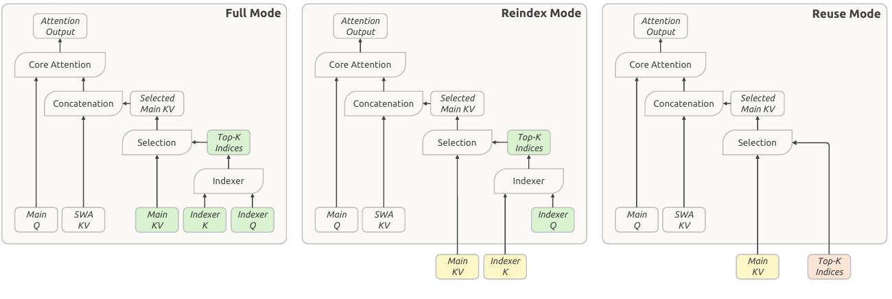

**그림 4. CSA2의 세 가지 동작 모드.** 각 모드는 주 KV, 인덱서 K, Top-K 인덱스를 얻는 방식이 다르다. 녹색 블록은 현재 계층에서 계산하는 값, 노란색 블록은 가장 최근의 Full 모드 계층에서 재사용한 주 KV와 인덱서 K, 빨간색 블록은 가장 최근에 인덱스를 생성한 Full 또는 Reindex 모드 계층에서 재사용한 Top-K 인덱스를 나타낸다. 세 모드 모두 현재 계층에서 주 Q와 SWA KV를 계산한다. Selection은 ‘선택’, Concatenation은 ‘연결’, Core Attention은 ‘핵심 어텐션 연산’, Attention Output은 ‘어텐션 출력’을 뜻한다.

CSA2는 세 차원을 함께 활용한다. 주 KV와 인덱서 K를 계층 간 공유하고 Top-K 인덱스도 재사용하게 하되, 캐시 공유와 인덱스 재사용은 서로 분리한다. 여기에 단순화한 압축기와, 디코더의 후속 인덱싱 계층이 탐색하는 영역을 좁혀 주는 계층적 희소 인덱서를 결합한다.

CSA와 마찬가지로 CSA2는 인덱서 Q와 인덱서 K를 사용해 주 KV 항목의 점수를 계산하고 쿼리마다 Top-K 항목을 선택하는 경량 인덱서를 포함한다. 각 Q는 선택된 항목 및 계층별 SWA KV에 함께 어텐션을 수행한다. 또한 압축비가 1인 경우를 특수한 경우로 포함하므로, 압축하지 않은 주 KV도 지원한다. 한편 압축기와 인덱서는 모두 단순화했다. CSA에서는 압축비 m일 때 원래 KV 캐시 항목 2m개로 하나의 주 KV 항목을 만들며, 인접한 압축 항목은 일부 원본 항목을 공유한다. 압축 과정에서 이 2m개 항목의 위치를 나타내기 위해 절대 위치 임베딩도 포함한다. CSA2는 이러한 중첩과 절대 위치 임베딩을 제거한다. 또한 은닉 상태로부터 별도의 압축 경로를 거치는 CSA와 달리, 주 KV 항목을 투영하여 인덱서 K를 얻는다. 두 설계 모두 구현을 단순화하고 학습 효율을 높인다.

2.3.1절과 2.3.2절에서는 각각 계층 간 재사용 전략과 계층적 희소 인덱서를 설명한다.

#### 2.3.1. 계층 간 KV 및 인덱스 재사용

각 CSA2 계층에는 Full, Reindex, Reuse 중 하나의 모드가 정적으로 할당된다. 세 모드 모두 계층별 쿼리와 SWA KV를 계산하고, 이를 선택한 주 KV 항목과 함께 사용하여 새로운 어텐션 출력을 만든다. 모드의 차이는 주 KV, 인덱서 K, Top-K 인덱스를 얻는 방식에 있다. 그림 4는 이 세 모드를 보여 준다.

**Full 모드.** 자체 주 KV와 인덱서 Q를 계산하고, 주 KV에서 인덱서 K를 투영한 뒤 인덱서를 실행하여 새로운 Top-K 인덱스를 만든다. 따라서 CSA2의 전체 계산 경로를 실행하며, 각 구성 요소의 역할은 DeepSeek-V4의 완전한 CSA 계층과 같다.

*원문 11쪽*

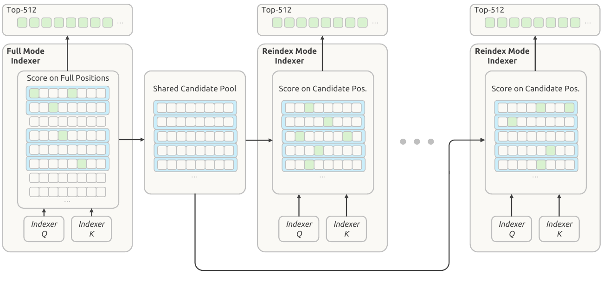

**그림 5. 계층적 희소 인덱서.** 사각형 하나는 한 위치를 나타낸다. 녹색 사각형은 선택된 인덱스, 파란색 직사각형은 블록 내 인덱서 점수의 최댓값을 기준으로 선택한 블록이다. 디코더의 첫 Full 모드 CSA2 계층은 자체 Top-512 인덱스를 선택하고, 선택한 블록으로 이후 계층이 공유할 후보 풀을 만든다. 이후 Reindex 모드 계층은 이 풀에서 Top-512 인덱스를 선택한다. Score on Full Positions는 ‘전체 위치의 점수 계산’, Shared Candidate Pool은 ‘공유 후보 풀’, Score on Candidate Pos.는 ‘후보 위치의 점수 계산’을 뜻한다.

**Reindex 모드.** 앞선 계층에서 사용할 수 있는 가장 최근의 주 KV와 이에 대응하는 인덱서 K를 재사용한다. 인덱서는 자체 쿼리를 계산하고, 재사용한 키의 점수를 다시 계산하여 새로운 Top-K 인덱스를 만든다. 따라서 주 KV와 인덱서 K를 공유하면서도 계층마다 희소 선택 결과를 바꿀 수 있다.

**Reuse 모드.** 가장 최근에 사용할 수 있는 주 KV와, 앞선 Full 또는 Reindex 모드 계층이 해당 주 KV에 대해 계산한 가장 최근의 Top-K 인덱스를 재사용한다. 인덱서 Q나 인덱스 점수를 계산하지 않고 이 선택 결과로 어텐션을 수행한다.

주 KV와 인덱서 K를 공유하면 캐시 저장량이 줄고, Top-K 인덱스를 재사용하면 추가 인덱서 연산이 사라진다. Reindex 모드는 캐시 공유를 유지하면서도 선택 항목을 계층별로 바꿀 수 있게 한다. CSA2를 CED와 결합할 때 Full 모드로 지정된 디코더 계층은 (L/2)번째 계층, 즉 인과적 인코더의 마지막 계층 은닉 상태에서 자체 전역 KV를 계산한다. Reindex와 Reuse 모드에는 변화가 없다.

#### 2.3.2. 계층적 희소 인덱서

계층 간 인덱스 재사용은 인덱서 계산 횟수를 줄이지만, 남은 인덱서는 여전히 인과적으로 볼 수 있는 전체 문맥의 점수를 계산한다. 문맥이 극도로 길면 이 비용은 주요 연산 병목으로 남는다. 선행 연구는 토큰 단위 인덱싱 전에 풀링한 블록 표현의 점수를 계산하고 가지치기하여 인덱서를 희소화했다(Xu et al., 2026b). 우리는 디코더에서 얕은 계층 인덱서의 정보를 활용하면, 추가 상태 없이도 더 깊은 인덱서가 고려할 후보를 자연스럽게 제한할 수 있음을 발견했다. 따라서 디코딩 중 반복되는 점수 계산을 줄이기 위해 CED 디코더에만 사용하는 계층적 희소 인덱서를 도입한다. 각 쿼리에 대해 첫 Full 모드 계층이 후보 풀을 만들고, 뒤의 재인덱싱 계층들은 이를 검색 영역으로 사용한다. 후보 풀의 크기가 고정되어 있으면 후속 인덱서의 쿼리당 비용은 문맥 길이에 비례하는 선형 비용에서 상수 비용으로 바뀐다.

*원문 12쪽*

이 기법은 학습을 고려하여 사후학습 단계에 도입한다. 후보 제한을 학습과 추론에 동일하게 적용하므로, 깊은 계층의 인덱서는 실제 추론에 사용할 검색 영역에서 최적화된다. 그림 5는 이 과정을 보여 준다.

첫 Full 모드 계층은 인과적으로 볼 수 있는 모든 주 KV 위치의 점수를 계산하여 자체 어텐션용 Top-K 인덱스를 만든다. 동시에 블록 단위 후보 선택도 수행한다. 각 블록의 점수는 해당 블록에 속한 위치들의 인덱스 점수 중 최댓값으로 정하고, 점수가 가장 높은 블록들을 선택한다. 선택한 블록에 포함된 위치를 모아 최종 Top-K 집합보다 큰 후보 풀을 구성한다. 예를 들어 위치가 8개씩 있는 블록 2,048개를 선택하면 후보 위치는 16,384개다. 이 풀은 이후 인덱서가 검색할 범위를 정하고, 최종 Top-K 선택은 각 계층이 실제로 읽을 주 KV 항목을 결정한다.

이후 Reindex 모드 계층은 해당 쿼리의 후보 위치만 점수화하고, 풀 안에서 자체 Top-K 항목을 고른다. Reuse 모드 계층은 새 인덱싱 없이 자신이 재사용하는 주 KV에 대해 계산된 가장 최근의 Top-K 인덱스를 사용한다. 즉, 인덱싱 계층들은 후보 풀을 공유하지만 최종 선택 결과는 서로 다를 수 있다.

후보 풀 크기가 고정되면 이후 각 인덱서가 쿼리당 점수를 계산하는 위치 수는 문맥 길이에 무관하게 제한된다. 다만 첫 Full 모드 계층은 여전히 인과적으로 볼 수 있는 전체 범위를 훑는다. 따라서 계층적 인덱싱은 최초의 전체 범위 처리를 유지하면서 후속 인덱서 계산 비용을 줄인다.

### 2.4. 효율적인 구조적 확장

#### 2.4.1. Single-Pass mHC

DeepSeek-V4에서는 인접한 트랜스포머 블록 사이에 n개의 잔차 스트림을 유지하는 mHC(Xie et al., 2026)를 도입했다. 각 토큰의 스트림을 X_l ∈ R^(n×d)로 나타내며, l은 블록 인덱스, d는 은닉 차원이다. 스트림은 다음과 같이 갱신된다.

$$X_{l+1}=B_lX_l+C_l\mathcal{F}_l(A_lX_l),\quad(A_l,B_l,C_l)=\mathcal{H}(X_l).\quad(2)$$

A_l ∈ R^(1×n), C_l ∈ R^(n×1), B_l ∈ R^(n×n)은 X_l로부터 예측한 토큰별 계수이며, 계수 예측기 H에는 정규화와 투영이 포함된다.

이상적으로 두 블록 사이의 잔차 변환은 (X_(l-1), Y_(l-1))을 (X_l, X̂_l)로 보내는 하나의 사상이다. 여기서 X̂_l = A_l X_l은 현재 블록 입력이고, Y_(l-1) = F_(l-1)(X̂_(l-1))은 이전 블록 출력이다. 이 사상에는 (n+1)d번의 읽기와 (n+1)d번의 쓰기가 필요하므로, 활성값 메모리 트래픽의 하한은 (2n+2)d다. 실제 DeepSeek-V4에서는 식 (2)를 여러 번 순회하는 방식으로 구현하며, 데이터 의존성 때문에 다음 세 커널을 순차 실행한다.

$$X_l=B_{l-1}X_{l-1}+C_{l-1}Y_{l-1}\qquad(3)$$

식 (3): 잔차 갱신, n 차원에 대한 축약.

$$(A_l,B_l,C_l)=\mathcal{H}(X_l)\qquad(4)$$

식 (4): 계수 계산, nd 차원에 대한 축약.

$$\hat{X}_l=A_lX_l\qquad(5)$$

식 (5): 입력 혼합, n 차원에 대한 축약.

세 커널은 각각 (n+1)d, nd, nd개의 값을 읽고, 합계 (n+1)d개를 쓴다. F_l 안의 사전 정규화까지 포함하면 총 활성값 메모리 트래픽은 (4n+4)d로 하한의 두 배다.

H에서는 정규화 가중치를 오프라인에서 투영 가중치에 합치고, RMS로 나누는 연산은 투영 뒤에 적용한다. 따라서 세 단계 중 두 단계는 잔차를 한 번 순회하는 동안 함께 수행할 수 있다. 잔차 갱신은 은닉 차원 전체의 리덕션이 필요하지 않으므로, X_l의 각 타일을 계산하는 즉시 투영 출력과 RMS 계산용 제곱합을 누적할 수 있다.

*원문 13쪽*

그러나 입력 혼합은 모든 은닉 타일의 리덕션이 끝나기 전까지 A_l을 얻을 수 없으므로 같은 순회에 융합할 수 없다. 따라서 X_l을 두 번째로 읽어야 한다. 두 번째 순회에는 입력 사전 정규화도 포함할 수 있다. 이 2회 순회 구현의 총 활성값 읽기·쓰기는 (3n+2)d로, 하한보다 X_l을 한 번 더 읽는다.

이에 따라 입력 혼합 계수를 한 블록만큼 이동시키는 Single-Pass mHC를 도입한다. 각 블록이 이전 블록에서 생성한 혼합 계수를 사용하게 하면 위 의존성이 사라진다.

$$X_{l+1}=B_lX_l+C_l\mathcal{F}_l(A_{l-1}X_l),\quad(A_l,B_l,C_l)=\mathcal{H}(X_l).\quad(6)$$

입력 혼합은 이제 A_l 대신 A_(l-1)을 사용하므로 X_l에서 계산한 계수에 의존하지 않는다. 따라서 각 X_l 타일을 전체 리덕션 완료를 기다리지 않고 입력 혼합과 계수 예측에 즉시 사용할 수 있다. 실험적으로 이러한 이동에 따른 성능 저하는 무시할 만큼 작았다.

사전학습에서는 각 블록이 적용하는 혼합 계수만 달라지므로 기존의 다중 커널 구현을 유지한다. 배포 시에는 잔차 갱신, 입력 혼합, 계수 예측을 Mega-mHC라는 단일 커널로 융합한다. 이 커널은 mHC를 (3n+2)d의 활성값 읽기·쓰기로, Single-Pass mHC를 (2n+2)d의 읽기·쓰기로 구현한다. Mega-mHC는 X_l을 은닉 차원 방향의 타일로 처리한다. 각 타일은 혼합 입력을 계산하고 다음 블록의 (A_l, B_l, C_l) 예측에 필요한 양을 누적하는 데 사용된다. 입력 사전 정규화와 FP8 변환도 커널에 포함된다. 그 결과 잔차를 한 번 읽고 한 번 쓰며, 이상적 사상의 (n+1)d 읽기 및 (n+1)d 쓰기를 달성하여 기존 구현의 활성값 메모리 트래픽을 절반으로 줄인다.

#### 2.4.2. Engram

기억과 연산을 분리하기 위해 이전 연구에서 도입한 조건부 메모리 모듈 Engram(Cheng et al., 2026c)을 추가한다. 토크나이저 압축, 다중 헤드 해싱, 문맥 인식 게이팅, 다중 분기 통합이라는 기존 Engram 설계를 따르되 두 가지를 수정했다. 첫째, 짧은 인과적 합성곱은 추론 스택의 복잡성을 늘리는 데 비해 성능 이득이 충분하지 않아 생략했다. 둘째, 2.5절에서 설명하듯 모멘텀 기반 갱신 후 Sinkhorn 균형화를 적용하여 Engram 임베딩을 최적화한다.

1,960억 개의 Engram 파라미터를 두 모듈에 균등하게 배분한다. 각 모듈은 N-그램 차수 {2, 3, 4}를 사용하며, 각 차수마다 해시 헤드 8개와 총 임베딩 차원 2048을 갖는다. 각 헤드는 약 1,600만 개 항목의 테이블을 인덱싱하고, 테이블 크기는 서로 다른 소수로 정한다. 임베딩 테이블과 키/값 투영에는 모두 FP8 정밀도를 사용한다. 학습 파이프라인 단계 간 메모리 사용량을 균형화하기 위해 모듈을 0부터 센 계층 1과 14에 배치한다. 추론에서는 결정적 주소 계산을 이용해 백그라운드 RDMA 전송으로 호스트 메모리에서 임베딩을 미리 가져올 수 있다. 첫 모듈의 프리페치는 첫 번째 트랜스포머 블록의 연산과 겹쳐 수행한다. Engram 학습 및 추론 구현의 세부사항은 3.1.3절에서 다룬다.

#### 2.4.3. DSpark

DeepSeek-V4.1-Flash에는 반자기회귀 초안 생성과 신뢰도에 따른 검증 스케줄링을 결합한 추측 디코딩 모듈 DSpark(Cheng et al., 2026a)를 탑재한다.

*원문 14쪽*

초안 모델은 어텐션 윈도 크기가 128토큰인 트랜스포머 블록 3개로 구성된다. 한 번의 순전파로 초안 위치 5개의 기본 로짓을 병렬 계산하며, 경량 마르코프 헤드가 초안 토큰 간 의존성을 모델링한다. 신뢰도 헤드는 위치별 조건부 수락 확률을 예측하고, 이를 사용해 접두부가 수락될 확률을 추정한다. 스케줄러는 이 추정값과 사전에 프로파일링한 엔진 처리량 곡선을 결합하여 각 요청의 검증 길이를 동적으로 선택한다. 목표는 현재 시스템 부하에서 시스템 전체의 기대 토큰 처리량을 최대화하는 것이다.

사전학습 내내 백본과 함께 학습하는 DeepSeek-V3의 MTP 모듈(DeepSeek-AI, 2024)과 달리, DSpark는 사전학습 이후의 전용 단계에서 도입한다. 이 단계에서는 백본을 고정하고 DSpark만 학습한다. 사후학습에서는 백본과 함께 DSpark 학습을 계속하되, DSpark 목적함수의 그래디언트가 백본으로 전파되지 않게 한다. 이렇게 하면 DSpark가 변화하는 정책과 계속 정렬되어, 온라인 서비스뿐 아니라 RL 및 OPD용 롤아웃 생성도 가속할 수 있다.

#### 2.4.4. FP4 주 KV 캐시

긴 문맥 에이전트 워크로드는 요청마다 큰 KV 캐시를 요구하여 서비스 비용을 높인다. DeepSeek-V4는 이미 FP4 인덱서 쿼리와 키에 양자화 인지 학습(QAT; Jacob et al., 2018)을 적용하여 인덱스 계산을 가속하고 인덱서 캐시를 줄인다. 실험에서 다른 포맷이 더 높은 정확도를 보였지만, 가능한 한 많은 하드웨어 플랫폼을 지원하기 위해 OCP 표준 MXFP4 포맷(Rouhani et al., 2023)을 채택했다. 이제 QAT를 주 KV 캐시로 확장한다. 여기서 FP4의 목적은 행렬곱 가속보다 저장량 감소다. 어텐션 전에 캐시 값을 역양자화하면 해당 포맷의 네이티브 행렬곱 지원 없이도 더 정확한 포맷을 사용할 수 있어, 하드웨어 플랫폼 간 호환성을 유지할 수 있다.

평가한 약 4비트 포맷 중에서, NVFP4(Alvarez et al., 2025)를 따라 채널 16개마다 E4M3 스케일 하나를 두는 E2M1을 선택했다. 다만 정확도와 단순성의 균형을 위해 두 번째 수준의 전역 스케일은 생략했다. 이를 생략해도 주 KV 캐시에는 충분한 동적 범위가 남는다. 이 포맷은 최대 448 × 6 = 2688의 크기를 표현하므로 캐시 값의 크기 상한보다 훨씬 넓다. DeepSeek-V4.1-Flash에서 학습된 RMSNorm 가중치의 최대 절댓값은 약 1이다. RMS 정규화 후 512채널 KV 잠재 표현의 L2 노름은 최대 약 √512다. RoPE는 이 노름을 보존하므로 회전 뒤 채널의 최대 절댓값도 약 √512 ≈ 22.6으로 제한된다. 실제 학습 중 관찰한 최대 크기는 약 10이다. 따라서 전역 스케일을 제거해도 측정 가능한 정확도 하락이 없으며 캐시 배치가 단순해진다.

FP4 주 KV 캐시 저장을 지원하기 위해 사후학습 중 QAT를 도입한다. RoPE 성분과 비-RoPE 성분에 같은 양자화 포맷을 사용한다. 캐시는 RoPE 이후에 양자화한다. 실험상 RoPE 전에 양자화할 때의 정확도 개선은 미미한 반면, 디코딩 오버헤드가 추가되기 때문이다. SWA KV 캐시는 양자화에 민감하여 FP8을 유지한다. DeepSeek-V4의 FP8 주 KV 캐시와 비교하면 HBM에서나 SSD로 오프로딩할 때나 저장량이 거의 절반으로 줄어든다.

### 2.5. 최적화

DeepSeek-V4의 최적화 설정을 바탕으로, 새 구조에 더 잘 맞도록 몇 가지를 변경했다. 첫째, 쿼리 가중치를 헤드별로 나눈 후 Muon 갱신을 적용하는 헤드별 Muon을 사용한다.

*원문 15쪽*

그 동기를 간략히 설명하면 다음과 같다. Muon을 전처리 조건자를 적용한 경사하강법으로 보면, 일반 Muon은 모든 헤드에 하나의 전처리 조건자를 사용하는 반면 헤드별 Muon은 각 헤드에 서로 다른 전처리 조건자를 제공한다. 이는 어텐션 헤드 간 이질성을 더 잘 다룰 수 있다(Zhang et al., 2024; Zhang, 2026, 3절). 실제로 헤드별 Muon이 일반 Muon보다 나은 성능을 보였다. 이러한 경험적 장점은 GLM 5(Zeng et al., 2026)와 Kimi-K3(Team et al., 2026a)에서도 확인되었다.

둘째, 새로 도입한 Engram 파라미터에 Adam을 적용하면 옵티마이저 상태 메모리가 크게 늘어난다. 학습 중 메모리 사용을 줄이기 위해 Engram 임베딩 테이블, 토큰 임베딩, 예측 헤드를 모멘텀 기반 갱신과 후속 Sinkhorn 균형화로 최적화한다. Sinkhorn 균형화는 SinkGD(Scetbon et al., 2025)에서 선형 계층의 가중치 행렬에 적용된 바 있으며, 여기서는 이를 대규모 파라미터 행렬로 확장한다. 이 방법은 Muon처럼 모멘텀 버퍼 하나만 필요하며, 실험에서는 Adam보다 나은 성능을 보였다.

**기본 설정.** 정규화 계층 가중치와 편향·스케일 인자 등 비행렬 파라미터에는 AdamW(Loshchilov and Hutter, 2019)를 유지한다. 언어 모델 백본의 선형 변환 가중치, Engram 투영 계층, 비전-언어 투영기에는 Muon(Jordan et al., 2024)을 사용한다. 쿼리와 키 가중치에는 헤드별 Muon을 사용한다. Muon에는 분리형 가중치 감쇠와 Nesterov 모멘텀을 적용한다(Nesterov, 1983; Liu et al., 2025). 정규화 계층 가중치에는 가중치 감쇠를 적용하지만 편향과 스케일 인자에는 적용하지 않는다. Sinkhorn 균형화 갱신도 Nesterov 모멘텀을 사용하지만 가중치 감쇠는 적용하지 않는다. 사전학습 중에는 학습률 감쇠 단계까지 비전 인코더를 고정하되, 마지막 정규화 계층과 비전-언어 투영기는 계속 학습한다. 학습률 감쇠가 시작되면 비전 인코더의 고정을 해제하고 더 작은 학습률로 LLM과 함께 최적화한다.

**Engram·임베딩·예측 헤드의 Sinkhorn 균형화 갱신.** 전체 절차는 알고리즘 1에 제시했다. 큰 흐름은 Muon과 같으며, Newton-Schulz 직교화 대신 Sinkhorn 균형화를 사용한다. 행렬의 더 큰 차원을 m으로 쓰며, 임베딩 테이블과 예측 헤드에서는 어휘 크기에 해당한다. 은닉 차원은 n으로 쓴다.

Nesterov 모멘텀 갱신 Ĝ_t가 주어지면, Sinkhorn 균형화는 다음 조건을 만족하는 대각 스케일 행렬 D_r, D_c를 구한다.

$$\Delta_t=\sqrt{n}U^{(K)}=\sqrt{n}D_r\hat{G}_tD_c,\quad\frac{1}{n}\sum_{j=1}^{n}(\Delta_t)_{ij}^{2}\approx1,\quad\frac{1}{m}\sum_{i=1}^{m}(\Delta_t)_{ij}^{2}\approx1.\ (7)$$

즉 갱신 행렬의 행별·열별 RMS를 대략 같게 만든다. 한 행은 하나의 토큰 인덱스 또는 n-그램 정체성에, 한 열은 하나의 은닉 특징에 해당한다. Sinkhorn 균형화는 양쪽 축을 정규화하여 이 토큰-특징 구조를 활용한다. 수치 안정성을 위해 ρ_i ≤ τρ̄인 행은 마스킹한다. √n 인자는 행의 단위 L2 노름을 행별 단위 RMS로 변환한다. 별도로 Adam의 갱신 크기와 맞추기 위해 유효 학습률을 η̃_t = γη_t로 조정한다. γ는 0.18로 설정하며, 이는 Moonlight(Liu et al., 2025)의 0.2와 가깝다.

더 넓게 보면 Sinkhorn 균형화는 행렬·텐서의 축 구조를 활용하는 옵티마이저들과 밀접하다(Shazeer and Stern, 2018; Zhang et al., 2025a; Wen et al., 2025; Glentis et al., 2025; Deng et al., 2026; Yuan et al., 2026; Xu et al., 2026a). 예를 들어 Adafactor는 다른 방식으로 행·열 정규화를 수행하고, Adam-mini는 임베딩 테이블과 예측 헤드에 다른 행별 정규화를 적용한다. 이런 전략은 최적화 성능과 통신 오버헤드가 다를 수 있으며, 자세한 연구는 향후 과제로 남긴다.

*원문 16쪽*

**알고리즘 1. Sinkhorn 균형화를 사용하는 모멘텀 갱신**

입력: 가중치 W_t ∈ R^(m×n), 그래디언트 G_t, 모멘텀 M_(t-1), 모멘텀 계수 β, 기본 학습률 η_t, 학습률 보정 γ, 수치 상수 ε와 τ, 홀수인 정규화 단계 수 K.

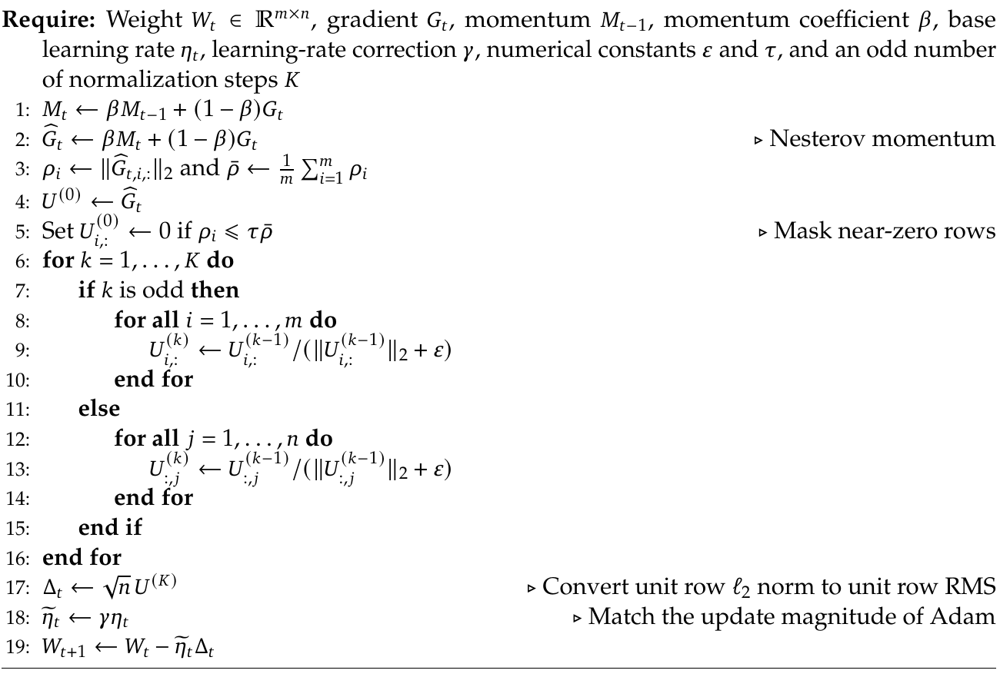

알고리즘의 주석 번역: 2행 ‘Nesterov momentum’은 ‘Nesterov 모멘텀’. 5행은 ‘거의 0인 행을 마스킹’. 6~16행은 k가 홀수일 때 각 행을, 짝수일 때 각 열을 L2 노름 + ε로 나누는 정규화를 반복한다. 17행은 ‘행의 단위 L2 노름을 행별 단위 RMS로 변환’. 18행은 ‘Adam의 갱신 크기에 맞춤’. 마지막 19행에서 보정한 학습률과 갱신 행렬로 가중치를 갱신한다. Require는 ‘입력 조건’, for는 ‘반복’, if/else는 ‘조건 분기’, end는 ‘종료’를 뜻한다.

## 3. 공통 인프라

### 3.1. 학습 인프라

#### 3.1.1. 멀티모달 학습 인프라

**대조 학습에서 통신과 연산의 중첩.** 비전 인코더는 먼저 대조 목적함수로 최적화한 뒤, 생성형 다음 토큰 예측 손실로 미세조정한다. 대조 학습 단계에서는 텍스트-이미지 쌍의 전체 배치에 대해 손실을 계산하므로, 두 모달리티의 특징을 데이터 병렬 랭크 전체에서 all-gather해야 한다. 이는 상당한 통신을 유발한다. 텍스트 특징의 그래디언트는 모은 시각 특징에만 의존하고, 반대로 시각 특징의 그래디언트는 모은 텍스트 특징에만 의존한다. 따라서 각 all-gather를 파이프라인을 멈추는 대신 순전파나 역전파와 겹쳐 수행할 수 있다.

$$\mathrm{Forward}(V)\ \to\ [\mathrm{Forward}(T)\parallel\mathrm{AllGather}(V)]\ \to\ \nabla\mathrm{Text}$$
$$\to\ [\mathrm{Backward}(T)\parallel\mathrm{AllGather}(T)]\ \to\ \nabla\mathrm{Vision}\ \to\ \mathrm{Backward}(V).$$

V와 T는 각각 시각·텍스트 특징, (A ∥ C)는 연산 A와 통신 C의 중첩, ∇는 그래디언트 계산을 뜻한다. 이 일정에서는 텍스트 순전파 동안 시각 특징을, 텍스트 역전파 동안 텍스트 특징을 수집한다.

*원문 17쪽*

이렇게 하면 두 all-gather를 모두 유용한 연산 뒤에 완전히 숨길 수 있다.

**종단 간 병렬화.** 비전 인코더와 LLM 사이의 모델 및 데이터 이질성(Zhang et al., 2025b)을 처리하기 위해, 최근 학습 시스템(Team et al., 2025, 2026b)의 분리형 인코더 설계를 채택했다. 비전 인코더는 LLM 파라미터 트리 외부에 복제하고, 학습 단계를 비전 인코더 순전파, LLM 순전파·역전파, 비전 인코더 역전파의 세 구간으로 나눈다. 이러한 분리는 비전 인코더와 LLM 연산 간 간섭을 방지한다. 부하를 균형화한 비전 처리는 첫 번째와 마지막 구간에서만 이루어지며, LLM 구간에는 비전 연산이 없어 텍스트 전용 학습의 병렬화 전략을 그대로 유지한다.

**긴 시퀀스 멀티모달 학습 최적화.** DeepSeek-V4.1-Flash는 최대 100만 토큰의 시퀀스로 학습하며, 사전학습과 사후학습 모두 상당 부분을 초장문 시퀀스에서 수행한다. 이 길이에서는 멀티모달 표본이 큰 I/O·CPU·메모리 병목을 만든다.

- **균형 잡힌 이미지 샤딩.** 사전학습에서는 이미지가 많은 초장문 시퀀스 하나만 적재해도 한 호스트의 I/O·CPU·메모리가 고갈될 수 있다. 따라서 시퀀스별 이미지를 문맥 병렬(CP) 랭크에 부하가 균형을 이루도록 나누며, 각 이미지는 정확히 한 번만 적재한다. 이미지를 한 번씩 읽는다면 다음 조건에서 적재 시간이 연산 뒤에 숨겨진다.

$$\frac{N\rho}{B_{IO}}<\frac{NC}{B_{GPU}}\quad\Longleftrightarrow\quad\rho<\frac{B_{IO}}{B_{GPU}}C.$$

여기서 N은 토큰 수, ρ는 토큰당 원시 바이트 수, C는 토큰당 연산량, B_IO와 B_GPU는 파일 시스템 및 GPU의 대역폭이다. N이 약분되므로 조건에는 토큰당 값인 ρ와 C만 남으며, 시퀀스 길이나 클러스터 크기와 무관하다. ρ는 해상도 상한이나 공간 다운샘플링 같은 비전 모듈 설정에 의해 결정된다. 따라서 저장장치 처리량은 절제 실험처럼 토큰당 연산이 적은 소형 모델에서만 병목이 되고, 실제 운영 규모의 모델은 연산에 의해 제한된다.

- **점진적 이미지 전송.** 위의 균형 샤딩에 더해, 강화학습 롤아웃에서는 이미지를 추론 엔진으로 점진적으로만 전송한다. 엔진이 CPU에서 수행한 디코딩과 전처리 결과는 분산 파일 시스템에 캐시하여 여러 롤아웃 및 후속 학습에서 재사용한다.

#### 3.1.2. CSA2의 어텐션 공유 학습

2.3절에서 소개한 CSA2의 세 모드 중 일부는 주 KV, 인덱서 K, Top-K 인덱스 중 하나 이상을 여러 계층에 공유한다. 대규모 분산 학습에서 이를 지원하려면 어텐션 연산 자체를 넘어서는 조정이 필요하다. 특히 어텐션 구성 요소를 공유하는 계층이 서로 다른 파이프라인 단계에 배치될 수 있어, 기존의 단계 내부 실행 방식에서는 모듈을 직접 재사용하기 어렵다. 이를 해결하기 위해 다음 설계를 채택했다.

**섀도 인덱서.** 공유 파라미터에는 단 하나의 논리적 소유자를 유지하면서, 참여하는 각 단계에 실행 가능한 경량 복제본을 배치한다. 소유자는 최적화와 체크포인트 저장을 담당하고, 파라미터 동기화와 그래디언트 집계로 학습 내내 섀도 복제본의 일관성을 유지한다. 이 설계는 파이프라인 스케줄러가 공유 계층을 특별한 실행 단위로 취급하지 않아도 원래 모델의 의미를 보존한다.

*원문 18쪽*

**파이프라인 페이로드 확장.** 원본 계층과 이를 사용하는 계층이 파이프라인 경계를 사이에 둘 때, 뒤쪽 사용 계층에 필요한 중간 표현과 희소 라우팅 정보를 전달한다. 이 상태들은 기존 점대점 통신 경로에 포함하고 문맥 병렬화에 맞춰 분할한다. 이에 따라 불필요한 복제를 피하면서 해당 그래디언트 흐름을 유지한다.

**마이크로배치 수준 공유 상태 관리.** 동시에 활성화된 파이프라인 마이크로배치의 상태를 추적하고, 순전파·활성값 재계산·역전파에 걸쳐 수명을 조정한다. 공유 상태는 마지막 사용자가 처리를 끝낼 때까지 유지한 뒤 즉시 해제하여 추가 메모리 오버헤드를 제한한다. 같은 런타임 추상화가 단계 배치 및 생성자-사용자 관계도 처리하므로, 어텐션 구현은 물리적 파이프라인 배치에 의존하지 않고 공유 상태에 접근할 수 있다.

이러한 기법에 옵티마이저·체크포인트·워밍업·계산 그래프 추적 흐름의 경량 수정을 더하면, 기존 분산 학습 인터페이스와 파이프라인 일정 아래에서 CSA2를 별도 구분 없이 동작시킬 수 있다.

#### 3.1.3. Engram

Engram 임베딩 테이블은 Engram 병렬 크기를 갖는 전용 프로세스 그룹에 행 단위로 분할한다. 그룹 크기는 장치당 메모리 사용량과 임베딩 조회의 통신 범위 사이 절충을 결정한다. 옵티마이저 상태는 각 테이블 파티션의 복제본 사이에서 추가로 샤딩한다. Engram 조회 인덱스는 입력 토큰 시퀀스에만 의존한다. 따라서 현재 학습 단계에서 각 파이프라인 단계가 마이크로배치를 처리하기 전에 전체 로컬 배치의 임베딩 프리페치를 시작하여 파이프라인 실행에 대한 간섭을 줄인다. 임베딩 그래디언트는 역전파 중 버퍼에 저장하고, 백본 역전파가 끝난 뒤 소유 랭크에 돌려준다.

멀티모달 학습과 효율적으로 통합하기 위해 임베딩 프리페치와 그래디언트 전송을 비전 인코더의 순전파 및 역전파 연산과 겹치도록 배치한다. 임베딩은 FP8로 저장하고 가져오며, 조회한 값과 스케일 인자는 다음 GEMM에 직접 전달한다. Engram 테이블 갱신 시 Sinkhorn 정규화는 반복 사이에 행·열 스케일 벡터를 유지하여 정규화한 전체 행렬을 반복해서 쓰지 않는다. 행 정규화와 부분 열 통계의 누적을 하나의 커널로 융합하여 메모리 트래픽을 더 줄인다. RL 롤아웃 중 Engram 임베딩 테이블은 GPU 메모리에 상주시킨다. 이는 호스트 메모리 부담을 낮추고 호스트 메모리 단편화로 인한 메모리 부족을 피하는 데 도움이 된다.

### 3.2. 추론 시스템

DeepSeek-V4.1-Flash는 추론 효율을 최우선 고려사항으로 설계했다. 개념적으로는 구조가 복잡하지만 실제 추론 커널 흐름은 매우 간결하다. 적절한 커널 융합으로 복잡한 연산을 묶고, 적은 수의 융합 커널 내부에서 하드웨어 자원이 충분히 파이프라인화되도록 한다. 여기에는 FlashMLA(Li and Liu, 2025)의 fused-RoPE-attention-RoPE-cast 커널, DeepGEMM(Zhao et al., 2025)의 Mega-Gate·Mega-mHC·Mega-MoE 커널, TileKernels(Wang et al., 2026a)의 커널, DeepSelect(Qian et al., 2026)의 TopK 커널이 포함된다. 그 결과 대부분의 트랜스포머 계층, 즉 CSA2가 Reuse 모드로 동작하는 계층은 프리필에서 15개, 디코딩에서 11개의 커널만 사용하여 높은 처리량과 낮은 지연을 동시에 달성한다.

*원문 19쪽*

배포 수준에서는 인코더-프리필-디코딩(Encoder-Prefill-Decode, EPD)을 분리하여, 비전 인코딩·프리필·디코딩을 각각 독립적으로 확장하고 실행을 중첩할 수 있게 한다.

#### 3.2.1. 영속 KV 캐시 관리

같은 워크로드에서 V4.1의 영속 KV 캐시는 V4의 1/8로 줄어든다. 두 가지 요인이 곱셈적으로 작용한다. 영속 KV 캐시에 SWA KV를 더 이상 보관하지 않아 크기를 거의 절반으로 줄이고, 남은 전역 KV도 구조 및 정밀도 최적화로 V4의 1/4로 압축한다.

V4 배포에서는 SWA KV가 영속 KV 캐시 용량의 거의 절반을 차지한다. 캐시 안에서 전역 KV와 SWA KV는 LRU 퇴거 정책에 따라 독립적으로 관리된다. 전역 KV는 전체를 저장하고, 적중하면 완전한 접두부를 재사용한다. 반면 SWA KV는 재생성과 다중 턴 세션을 지원하도록 프롬프트 끝과 출력 끝이라는 두 위치에 캐시하며, 적중하면 해당 위치에서 계산을 재개한다. 높은 적중률을 유지하기 위해 SSD의 영속 캐시를 충분히 크게 구성하여, 일반 워크로드에서 두 종류의 KV가 모두 72시간 넘게 상주하도록 했다. 지정한 위치마다 n_win개의 KV 항목만 유지하더라도, 압축하지 않은 SWA KV는 특히 각 턴이 짧은 다중 턴 대화에서 상당한 저장 오버헤드를 유발한다.

SWA KV의 영속 저장은 비용이 크고 효과도 낮다. 접근 패턴이 영속 캐시의 긴 보존 정책과 맞지 않기 때문이다. 긴 꼬리 형태의 재사용을 보이는 전역 KV와 달리, SWA KV는 활성 세션 안의 짧은 수분 단위 시간대에서만 재사용되며 세션이 끝나거나 다음 턴이 시작되면 쓸모가 없어진다. V4 기술 보고서는 누락된 SWA KV를 재계산하여 저장 오버헤드를 없애는 Zero SWA Caching을 제안했다. 그러나 정확히 복원하려면 L × n_win개 토큰의 전체 순전파가 필요하고, 실제 운영에서는 그 비용이 지나치게 컸다.

V4.1은 영속 KV 캐시 관리를 다음처럼 수정한다.

1. SWA KV는 영속 캐시에 저장하지 않고 각 머신 호스트 DRAM의 10%로 구성한 분산 메모리 풀에 보관한다. 총용량은 훨씬 작지만 TTL이 수분으로 짧아 만료 항목을 새 세션에 즉시 재사용할 수 있다. 실제 워크로드에서는 높은 회전율 덕분에 대부분의 동시 활성 세션을 처리하기에 충분하다. 전역 KV는 수명을 최소 72시간 보장하며 영속 캐시에 유지한다.
2. SWA KV를 퇴거하면 불가피하게 미스가 발생하지만, 3.2.2절의 경량 대체 경로인 ‘인코더 SWA 제한 재실행’으로 비용을 낮게 유지한다. 전역 KV에는 적중하지만 SWA KV에는 적중하지 못하는 드문 요청에서는 L × n_win개 토큰의 전체 순전파 대신 n_win개 토큰만 재계산하여 누락 상태를 복원한다. 이 제한 재실행이 설계의 핵심이다. 치명적으로 비싼 캐시 미스를 완만하고 저렴한 성능 저하로 바꿔, 영속 캐시에서 SWA KV를 제거할 근거를 제공한다.

#### 3.2.2. SWA 제한 재실행

*원문 20쪽*

SWA의 의존성은 계층을 따라 누적되므로 L개 계층의 SWA KV를 정확히 복원하려면 L × n_win개 토큰을 재실행해야 한다. SWA 제한 재실행은 대신 가장 최근의 n_win개 토큰만 재실행하고 SWA를 재실행 구간으로 잘라 근사 상태를 허용한다. 위치 s에서 재실행을 시작하면 위치 i의 쿼리는 [max(s, i-W+1), i] 구간의 SWA 키에 어텐션을 수행한다.

**인코더 SWA 제한 재실행.** 접두부 캐싱이 전역 KV에만 의존하게 하여, 영속 캐시에서 SWA KV를 제거할 수 있게 한다. 인코더 SWA KV가 없으면 캐시된 접두부의 마지막 n_win개 토큰을 재실행하고, 캐시되지 않은 접미부와 함께 처리한다. 재실행 토큰은 SWA KV만 다시 생성하며, 캐시된 전역 KV는 재계산하거나 덮어쓰지 않고 재사용한다. 캐시되지 않은 접미부에서는 전역 KV와 SWA KV를 모두 생성한다.

설계상 재실행한 접두부 상태는 근사치다. 따라서 캐시되지 않은 접미부에서 계산한 전역 KV와 SWA KV는 캐시 적중 위치에 따라 달라지며, 서로 다른 위치에서 수학적으로 동일하지 않다. 다행히 실험 결과 이 제한 재실행 전략은 응답 품질을 거의 떨어뜨리지 않았다.

**디코더 SWA 제한 재실행.** 디코더 순전파를 n_win개 토큰으로 제한하여 전체 프리필 연산을 거의 절반으로 줄인다. CED에서는 디코더 전역 KV를 마지막 인코더 은닉 상태에서 투영한다. 프리필을 인코더에서 끝내는 데 유일한 장애물은, 각 디코더 계층의 자체 은닉 상태에서 생성되며 초기 디코딩에 필요한 디코더 SWA KV다. 디코더 SWA KV는 캐시하지 않으므로, 정확히 재구성하려면 마지막 (L/2) × n_win개 프롬프트 토큰을 L/2개 디코더 계층에 통과시켜야 한다. 긴 캐시 접두부 뒤에 짧은 미캐시 접미부가 붙는 경우 특히 비싸다. 따라서 이 경우에도 제한 재실행을 적용한다. 매 프리필에서 프롬프트의 마지막 n_win개 토큰을 재실행하고, 그 인코더 출력을 같은 SWA 절단 조건으로 디코더에 통과시킨다. 이렇게 얻은 디코더 SWA KV는 접두부 캐싱이 아닌 디코딩에만 사용한다.

설계상 재구성한 디코더 SWA KV는 전체 디코더 순전파로 얻은 값과 수학적으로 같지 않다. 하지만 이 전략 역시 응답 품질에 미치는 영향이 미미했다. 추가적인 안정성을 위해 사후학습 중에도 같은 재실행을 모사하여 학습을 통한 적응을 수행한다.

## 4. 사전학습

### 4.1. 데이터 구축

**텍스트 데이터 선별.** 더 높은 지능을 추구하기 위해 소규모 데이터 실험이 보여 주는 일반적인 표본 수준 품질을 넘어, 고유한 정보 이득을 제공하는 다양한 코퍼스 간 전체적인 상호작용에 더 집중한다. 데이터 품질을 높이고 혼합 비율을 최적화하기 위해 더 체계적이고 표준화된 구축 파이프라인을 채택한다. 구체적으로 더 종합적인 평가를 바탕으로 모델 파라미터와 학습 데이터의 규모를 단계적으로 늘리는 실험 체계를 세심하게 설계하여 대규모 학습을 안내한다. 성능이 낮은 모델의 출력과 품질이 낮은 기계 번역문 등, 정보 이득이 제한적인 모델 생성 콘텐츠를 걸러낸다. 이런 콘텐츠는 주로 기존 정보를 다른 말로 표현하므로 암묵적인 중복으로 간주하며, 긴 학습 과정에서는 오히려 해로울 수 있다.

*원문 21쪽*

향후 대규모 합성 데이터의 기반으로 모델을 반복 과정에 참여시키는 데이터 개선 방식도 탐색한다. 아울러 더 많은 도메인 전문가를 참여시켜 세분화된 데이터 품질 평가 차원을 구축한다. 이전 버전보다 새 코퍼스에는 최근 공개된 오픈소스 저장소·커밋·라이브러리·신흥 프레임워크의 최신 코드가 더 많이 포함된다. 이를 통해 더 다양한 프로그래밍 언어를 다루고 오늘날 실제 소프트웨어 엔지니어링 상황을 더 잘 반영한다.

**멀티모달 데이터 선별.** 멀티모달 사전학습 데이터는 주로 이미지-텍스트 쌍, 이미지와 텍스트가 교차 배치된 데이터, 도메인 특화 데이터의 세 종류로 구성된다. 원시 웹 데이터가 본래 풍부한 멀티모달 지식을 제공한다는 전제 아래 대규모 데이터 합성을 삼갔으며, 대신 데이터를 원형대로 정제하고 활용하는 데 우선순위를 두었다. 이는 사전학습에서 가장 직접적이고 확장 가능한 방식으로 시각 지식을 압축하기 위한 선택이다. 초기 수집에서 크롤링 시스템이 텍스트 중심 웹 콘텐츠에 지나치게 편향되어 있음을 발견하여, Common Crawl을 기반으로 다시 구축하고 멀티모달 출처의 범위를 넓혔다.

이미지-텍스트 데이터는 웹페이지의 이미지와 관련 대체 텍스트(alt text)를 추출한 뒤, 이미지-텍스트 관련성 임계값으로 필터링하고 이미지 의미에 기반해 중복을 제거한다. 교차 배치 데이터는 주로 웹페이지와 PDF에서 구축한다. 대규모 멀티모달 코퍼스 처리는 텍스트 전용 코퍼스보다 CPU 및 디스크 비용이 크므로, 구축 과정을 비용이 점차 증가하는 단계로 나눴다. 이미지 수집 전에 휴리스틱·통계 필터링, 중복 제거, 품질 모델로 가치가 높은 문서를 선택한다. 살아남은 문서를 이미지-텍스트 교차 시퀀스로 조합한 뒤, 이미지를 고려한 방식으로 다시 필터링하고 중복을 제거한다. 마지막으로 SmolVLM(Marafioti et al., 2025)으로 이미지-텍스트 내용의 품질을 엄격하게 평가하여 고품질 교차 데이터를 추출한다. 이 과정에서 제외된 문서 일부는 선별과 재조합을 통해 추가 이미지-텍스트 쌍으로 재활용한다.

웹 수집 데이터의 내재적 한계를 보완하기 위해 도메인 특화 데이터셋도 포함한다. 이를 통해 시각적 위치 연결 및 지점 지정 같은 세밀한 시각 지각, 광학 문자 인식(OCR), 롱테일 지식 습득 역량을 강화한다. 멀티모달 에이전트 이해를 높이기 위해 다량의 이미지-코드 쌍과 컴퓨터 사용 궤적도 수집한다.

**데이터 통합 및 중복 제거.** 텍스트 전용 데이터와 멀티모달 데이터는 별도 파이프라인으로 처리했으므로, 최종 코퍼스는 두 출처의 합집합으로 구성한다. 겹치는 표본은 텍스트 전용 버전을 멀티모달 버전으로 교체하고, 두 설정 중 더 큰 에포크 수를 사용한다. 교체 후 텍스트 전용 대 멀티모달 토큰 비율은 7:1이다. 사전학습과 문맥 확장 동안 표본을 공동으로 프리페치하고 배정하여 중복을 최소화한다. 초장문 문서는 혼합 전에 결정적으로 미리 분할하여 데이터 샤드 및 학습 단계 전반에 토큰이 균일하게 분포하도록 한다. 최적 적합 패킹 알고리즘도 개선하여 패딩 비율을 최대 10^-4로 낮췄다.

### 4.2. 사전학습 설정

#### 4.2.1. 모델 설정

트랜스포머 계층 수는 40, 은닉 차원 d는 5120으로 설정한다. CED 구조에서 인코더와 디코더는 각각 20개 계층이다. 처음 두 계층에는 SWA만 사용한다.

*원문 22쪽*

나머지 인코더 18개 계층에는 압축비 m=2인 CSA2를 사용한다. 6개 계층씩 동일한 구성의 세 그룹으로 나누며, 각 그룹의 첫 계층은 Full 모드, 나머지 5개는 Reuse 모드다. 디코더 20개 계층은 압축비 m=1인 CSA2를 사용하며, 4개 계층씩 다섯 그룹으로 나눈다. 첫 그룹의 첫 계층은 Full 모드, 나머지 3개는 Reuse 모드다. 뒤의 네 그룹은 모두 첫 계층이 Reindex 모드, 나머지 3개가 Reuse 모드다.

모든 CSA2 계층에서 인덱서 쿼리 헤드 수는 32, 인덱서 헤드 차원은 128, 희소 어텐션용으로 선택하는 KV 항목 수(attention top-k)는 512다. 쿼리 헤드 수는 64, 헤드 차원은 512, 쿼리 압축 차원은 1280이다. 계층적 희소 인덱서는 위치 8개로 된 블록을 최대 2,048개 선택하여 총 최대 16,384개 후보 위치를 만든다. 출력 투영 그룹 수는 8, 각 중간 어텐션 출력의 차원은 1024다. 추가 SWA 분기의 윈도 크기 n_win은 128이다.

모든 트랜스포머 블록에 MoE 계층을 사용하고, 임계값 10에서 클램핑하는 SwiGLU 활성화 함수(OpenAI, 2025)를 적용한다. 각 MoE 계층에는 공유 전문가 1개와 라우팅 전문가 384개가 있으며, 전문가별 중간 은닉 차원은 2304다. 각 토큰은 라우팅 전문가 중 6개를 활성화한다. mHC의 확장 계수는 4, Sinkhorn-Knopp 반복 횟수는 20이다. 비전 인코더는 32개 계층, 은닉 차원 1024, 어텐션 헤드 16개, 이미지 패치 크기 14를 사용한다. 비전 MLP 투영기는 은닉 차원 5120의 2개 계층이다. 이 설정에서 백본 파라미터는 5,520억 개이며, 토큰당 프리필 80억 개, 디코딩 160억 개가 활성화된다.

#### 4.2.2. 학습 설정

선형 변환 파라미터에는 Muon(Jordan et al., 2024; Liu et al., 2025), 모든 RMSNorm 가중치와 기타 비행렬 파라미터에는 AdamW(Loshchilov and Hutter, 2019), 모든 임베딩과 예측 헤드에는 Sinkhorn 균형화 갱신을 사용한다. AdamW의 초매개변수는 β₁=0.9, β₂=0.95, ε=10^-20, weight_decay=0.1이다. Muon의 모멘텀은 0.95, 가중치 감쇠는 0.1이며, AdamW의 학습률을 재사용할 수 있도록 각 갱신 행렬의 RMS를 0.18로 조정한다. Sinkhorn 갱신은 Muon과 같은 모멘텀 및 학습률 보정 계수를 사용하고 K=11, τ=10^-3, ε=10^-20으로 설정한다. Cheng et al.(2026b)에 따라 Engram의 학습률은 5배로 설정한다.

45조 토큰의 멀티모달 데이터로 불안정성 없이 학습했다. 배치 크기는 학습 내내 1억 60만 토큰으로 고정했다. 처음 2,000단계 동안 학습률을 선형으로 워밍업한 후, 28조 토큰까지 2.6 × 10^-4로 유지한다. 28조~40조 토큰에서는 코사인 일정에 따라 2.6 × 10^-5까지 낮추고, 40조~45조 토큰에서는 이 값을 유지한다. 처음부터 시퀀스 길이 64K에서 희소 어텐션으로 학습하고, 34조 토큰 시점에 길이를 1M으로 확장한다. 보조 손실 없는 부하 분산의 편향 갱신 속도는 이미지와 텍스트 모두 0.001이다. 단일 시퀀스 내 극심한 불균형을 피하기 위해 가중치 0.0001의 작은 시퀀스 수준 균형 손실도 유지한다. DeepSeek-V4와 마찬가지로 사전학습 중 표본 수준 어텐션 마스킹을 사용한다.

**비전 인코더 학습.** DeepSeek-ViT는 언어 백본에 통합하기 전에 별도의 학습을 거친다. 파이프라인은 대조 사전학습과 자기회귀 미세조정의 두 단계다.

*원문 23쪽*

대조 사전학습에서는 대체 텍스트 데이터에서 얻은 약 470억 개 이미지-텍스트 쌍에 SigLIP(Zhai et al., 2023)의 시그모이드 대조 손실을 적용한다. 이처럼 큰 데이터에서 효율적으로 시각 표현을 학습하기 위해 큰 이미지는 종횡비를 유지하며 축소하고, 최대 입력 해상도를 224 × 224픽셀로 제한한다. 이 단계에서 해상도를 높이면 상당한 이득이 있지만, 실험상 최종 모델에 대한 기여는 작았다. 이후 자기회귀 단계가 고해상도 외삽을 별도로 담당하므로, 대조 사전학습의 해상도 증가는 전체 개선은 작으면서 연산 오버헤드만 크게 늘린다.

자기회귀 미세조정에서는 비전 인코더를 40억 파라미터 MoE LLM에 연결하고, 이미지 캡션·대체 텍스트·차트·OCR 데이터 등을 포함한 2,360억 토큰에 다음 토큰 예측 목적함수로 학습한다. 목적은 세밀한 시각 특징의 모델링 역량을 강화하는 것이다. 이에 따라 범위를 벗어난 이미지는 비례 조정하여 입력 해상도를 544 × 544~1344 × 1344픽셀로 제한한다. 이 단계가 끝나면 LLM은 버리고 최적화한 비전 인코더만 후속 사전학습에 사용하며, 같은 해상도 정책을 유지한다.

### 4.3. 평가

#### 4.3.1. 평가 벤치마크

DeepSeek-V4.1-Flash-Base를 이전 모델인 DeepSeek-V4-Flash-Base 및 DeepSeek-V4-Pro-Base와 비교한다. 세상 지식, 언어 이해·추론, 코딩·수학, 긴 문맥, 멀티모달 역량의 다섯 주요 차원에 걸쳐 결과를 보고한다.

- **세상 지식:** AGIEval(Zhong et al., 2023), MMLU-Pro(Wang et al., 2024b), C-Eval(Huang et al., 2023), MultiLoKo(Hupkes and Bogoychev, 2025), SimpleQA-Verified(Haas et al., 2025), SuperGPQA(Du et al., 2025).
- **언어 이해와 추론:** BigBench Hard(BBH; Suzgun et al., 2022), BigBench Extra Hard(BBEH; Kazemi et al., 2025), DROP(Dua et al., 2019), HellaSwag(Zellers et al., 2019).
- **코딩과 수학:** BigCodeBench(Zhuo et al., 2025), HumanEval(Chen et al., 2021), GSM8K(Cobbe et al., 2021), MATH(Hendrycks et al., 2021), MGSM(Shi et al., 2023).
- **긴 문맥:** LongBench-V2(Bai et al., 2025).
- **멀티모달:** MMMU-Pro(Yue et al., 2025), DocVQA(Mathew et al., 2021), CVBench(Tong et al., 2024), RefCOCO/RefCOCO+/RefCOCO-g(Kazemzadeh et al., 2014; Nagaraja et al., 2016; Mao et al., 2016; Yu et al., 2016).

#### 4.3.2. 평가 결과

표 1은 내부 평가 프레임워크에서 엄격하게 통제되고 재현 가능한 설정으로 평가한 DeepSeek-V4-Flash, DeepSeek-V4-Pro, DeepSeek-V4.1-Flash 기본 모델을 자세히 비교한다. 최신 기본 모델은 앞선 두 모델에 비해 뚜렷한 효율 향상을 보인다. DeepSeek-V4.1-Flash는 DeepSeek-V4-Pro-Base보다 활성화 파라미터가 훨씬 적고 KV 캐시도 크게 작지만, 성능은 완전히 대등하다.

*원문 24쪽*

**표 1.** DeepSeek-V4-Flash-Base, DeepSeek-V4-Pro-Base, DeepSeek-V4.1-Flash-Base 비교. 모든 모델을 같은 내부 프레임워크와 평가 설정으로 평가했다. 점수 차이가 0.3 이하이면 같은 수준으로 간주한다. 각 행의 최고 점수는 굵게, 두 번째 점수는 밑줄로 표시했다.

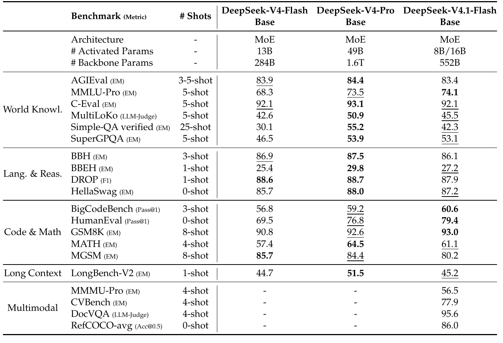

표 머리글 및 범주 번역: Benchmark (Metric) = 벤치마크(지표), # Shots = 예시 수, Architecture = 구조, # Activated Params = 활성화 파라미터 수, # Backbone Params = 백본 파라미터 수, World Knowl. = 세상 지식, Lang. & Reas. = 언어 및 추론, Code & Math = 코딩 및 수학, Long Context = 긴 문맥, Multimodal = 멀티모달. B는 10억, T는 1조 단위다. EM은 정확 일치, LLM-Judge는 LLM 판정, Pass@1은 단일 시도 성공률을 뜻한다.

이 결과는 사전학습 데이터 선별 파이프라인의 상당한 개선도 반영한다. 이번 버전에서는 처음부터 멀티모달 학습을 도입하고 관련 평가로 효과를 검증했다. 더 다양하고 멀티모달인 코퍼스로 학습한 DeepSeek-V4.1-Flash는 DeepSeek-V4-Pro와 비슷한 세상 지식 및 이해 역량을 달성한다. 추론과 코딩 벤치마크에서는 일관된 진전을 보이며, 여러 벤치마크에서 DeepSeek-V4-Pro에 근접하거나 더 높은 성능을 달성했다.

실제 연구개발 상황의 역량을 더 평가하기 위해, 전용 내부 코퍼스에서 퍼플렉시티 검사도 수행했다. 모델 API로는 퍼플렉시티를 검사할 수 없으므로 주로 자체 사전학습 기본 모델에 집중했다. 코퍼스는 일상적인 개발을 바탕으로 별도 평가 세트를 수집해 구성했으며, 내부 문서·비공개 코드 저장소·학술 자료를 포함한다. 복잡한 과학 문제와 첨단 연구에서의 추론, 근거 귀속, 문제 해결을 평가하도록 설계했다. 결과는 그림 6에 제시하며 모델별 바이트당 비트 수(bits-per-byte, BPB)를 보고한다. 값이 낮을수록 성능이 좋다.

*원문 25쪽*

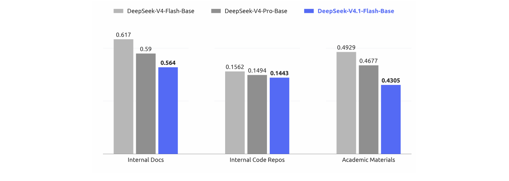

**그림 6.** 학습에서 제외한 평가 세트에서 DeepSeek-V4-Flash-Base, DeepSeek-V4-Pro-Base, DeepSeek-V4.1-Flash-Base의 BPB 비교. DeepSeek-V4.1-Flash-Base가 모든 과제에서 가장 낮은 BPB를 달성하여 강력한 기본 모델로서 더 큰 잠재력을 보여 준다. BPB는 ‘바이트당 비트 수’, Internal Docs는 ‘내부 문서’, Internal Code Repos는 ‘내부 코드 저장소’, Academic Materials는 ‘학술 자료’를 뜻한다.

## 5. 사후학습

### 5.1. 사후학습 파이프라인

이번 공개에서는 새로운 사후학습 알고리즘을 도입하지 않는다. 전체 방식은 지도 미세조정(SFT), 강화학습(RL), 온폴리시 증류(OPD; Gu et al., 2024; Lu and Lab, 2025)로 이어지는 표준 패러다임을 따르며, 확립된 관행을 넘어서는 알고리즘 수정은 없다. 대신 모델을 어떻게 최적화하는가보다 무엇으로 학습시키는가에 거의 모든 노력을 집중했다. 즉 데이터 합성과 환경 구축을 위한 대규모 자동화 파이프라인에 투자했다.

구체적으로 파이프라인은 (i) 참조 풀이와 보상 신호를 갖춘 다양하고 검증 가능한 학습 과제를 합성하고, (ii) 저렴하게 궤적을 수집·평가할 수 있는 상호작용형 에이전트 환경을 절차적으로 구축·확장하며, (iii) 엄격한 필터링·중복 제거·난이도 보정으로 데이터 품질과 커리큘럼 균형을 확보한다. 고정된 평범한 최적화 절차에서도 합성 데이터와 환경의 규모·다양성·검증 가능성을 체계적으로 개선하면 관찰된 이득의 사실상 전부를 설명할 수 있었다. 이는 현 단계에서 사후학습 알고리즘의 새로움보다 데이터와 환경 파이프라인을 설계하는 데서 얻는 한계수익이 훨씬 크다는 더 일반적인 교훈과도 맞닿아 있다.

#### 5.1.1. 대규모 에이전트 과제 합성

과제는 에이전트 학습의 기본 연료다. 그러나 고품질 학습 과제의 구축에는 전통적으로 많은 수작업이 필요했다. 우리는 모델이 아직 완벽하지는 않지만 자체 학습 과제를 만들 능력을 보이기 시작했음을 관찰했다. 이 가능성을 바탕으로 모델의 과제 구축 및 품질 검증 역량을 강화하는 데 상당한 노력을 기울였다.

각 과제를 (문제, 환경, 검증 시스템)의 세 요소로 형식화하고, ‘난이도’와 ‘정확성’의 두 차원에서 품질을 평가한다. 난이도는 과제가 자명하지 않도록 하고, 정확성은 세 구성 요소에 중대한 결함이 없도록 보장한다. 두 값을 보상 신호로 삼아 모델이 더 나은 과제를 만들도록 반복 학습한다. 또한 RL 과제의 전체 생애주기를 관찰한다. 어떤 과제를 새 RL 실행에 사용하면 그 결과 궤적이 품질 재검토를 위한 새로운 근거가 된다.

*원문 26쪽*

이 일반적인 틀 아래 범용 에이전트와 코딩 에이전트라는 두 핵심 상황을 위한 전용 학습 환경 생산 파이프라인을 구축했다.

**범용 에이전트.** 내부 직원과 외부 파트너가 최신 모델을 일상 업무에 사용하고 자발적으로 상호작용 데이터 및 피드백을 제공하도록 장려한다. 반환된 데이터에서 관찰한 인터페이스를 바탕으로 실제 도구·시스템의 인터페이스와 동작을 재현하는 대규모 모의 도구 집합을 만든다. 입력 형식, 출력 구조, API 스키마, 동작 제약을 포함하며, 흔히 쓰이는 SaaS·기업용 애플리케이션부터 전문적인 업무 백엔드까지 포괄한다. 동시에 내부 직원의 부정적 피드백과 모델 실패 사례를 대규모로 수집하여, 실제 업무 흐름에 기반한 단일 턴 및 다중 턴 에이전트 환경을 생성하는 파이프라인에 반영한다. 관련 도구 문맥, 사용자 상호작용 패턴, 실패 조건을 재구성함으로써 실패를 체계적으로 재실행하고 관찰된 약점에 집중한 강화학습을 수행할 수 있다.

**코딩 에이전트.** 학습 환경은 두 출처에서 구축한다. (1) 내부 직원과 외부 파트너의 코딩 에이전트 세션 중 매우 복잡하거나 모델 성능이 낮은 과제를 선별하고 궤적별 중복을 제거한다. (2) 별 개수 기준을 충족하는 공개 GitHub 저장소를 사용한다. 환경 구축은 여러 전문 에이전트가 협력해 수행한다. 먼저 한 에이전트가 프로젝트를 컨테이너 안에서 빌드하고 완전히 실행할 수 있는지, 자동 검증이 가능한지 판단한다. 가능하면 특정 턴 또는 커밋을 시작점으로 정하고, 충분히 복잡한 여러 구현 방향과 구체적인 평가 항목을 설계한다. 평가에는 실패에서 성공으로 바뀌어야 하는 항목(fail-to-pass)과 기존 성공을 유지해야 하는 항목(pass-to-pass)을 모두 포함한다. 필요에 따라 웹에서 외부 자원을 가져와 구축 보고서도 만든다.

다음으로 별도의 에이전트가 격리된 컨테이너에 의존성, 초기 작업 디렉터리, 테스트 코드, 과제 설명을 설정한다. 자체 테스트를 수행하고 정답을 누설할 수 있는 흔적을 제거한 뒤 새 이미지 계층으로 패키징한다. 이후 서로 다른 여러 에이전트가 풀이를 시도하고, 독립적인 품질 검사 에이전트가 환경과 풀이 궤적을 검토한다. 환경 문제, 사실 오류, 평가 항목과 과제 설명의 불일치, 편법 공략 위험을 점검한다. 검사를 통과하지 못하면 복구 에이전트가 확인된 오류를 모두 고치고 너무 쉽거나 어려운 평가 항목을 조정한 뒤 다시 검증한다.

이 파이프라인으로 정확하고 변별력이 있으며 길이와 난이도를 제어할 수 있는 RL 데이터를 자동으로 일괄 생산한다. 범용 환경에서 실제 업무를 충실히 재구성하든 코딩 환경에서 과제를 정밀하게 구축하든, 최종 결과는 하나의 통합 학습 시스템에 공급되어 지속적인 품질 관찰 아래 모델 역량의 반복적 개선을 이끈다.

#### 5.1.2. 합성 과제에서의 강화학습

합성 과제에 대규모 비동기 RL을 적용해 성능을 높이고 복잡한 상황에서의 행동을 형성한다. RL은 학습 연산량과 스캐폴드 수의 두 차원에서 확장한다. 그림 7과 8처럼 하나의 스캐폴드 안에서든, 같은 스캐폴드의 여러 버전을 함께 학습하든, 서로 다른 스캐폴드를 함께 학습하든, 누적 RL 단계와 연산량이 늘수록 성능이 계속 개선된다. 여기서 스캐폴드는 에이전트의 도구·실행·상호작용을 구성하는 주변 실행 틀을 말한다.

다양한 스캐폴드의 RL을 위해 롤아웃 실행을 에이전트 샌드박스와 워커 컨테이너로 분리한다. 샌드박스는 스캐폴드와 도구를 실행하고, 워커는 특정 스캐폴드에 종속되지 않는 제어 계층을 제공한다.

*원문 27쪽*

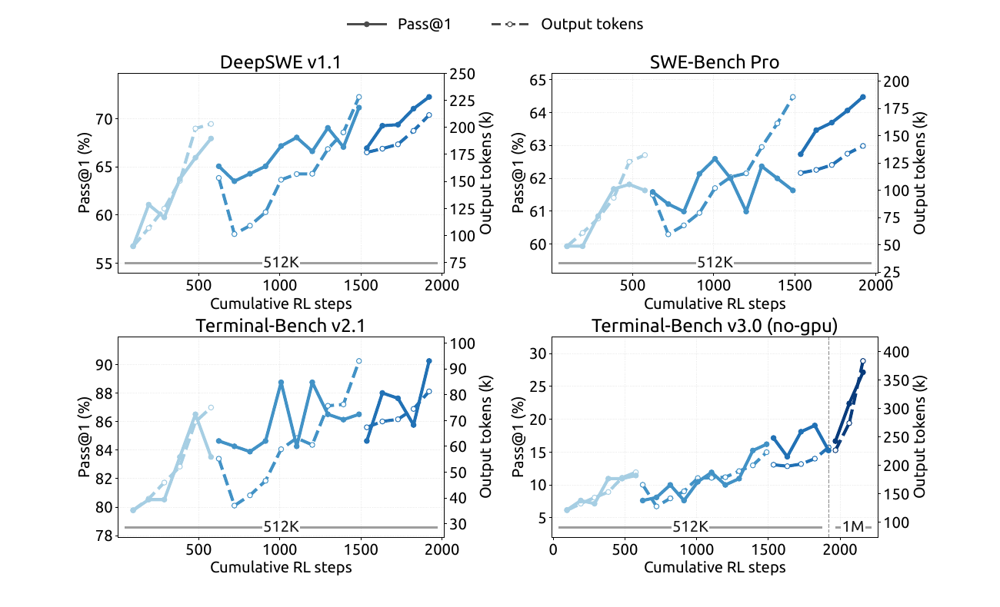

**그림 7.** DeepSeek Harness의 Minimal 모드에서 RL 학습을 확장할수록 여러 코딩 에이전트 벤치마크의 성능이 개선된다. 최대 문맥 길이를 1M으로 더 늘리면 Terminal-Bench v3.0 같은 매우 장기적인 과제의 성능도 계속 향상된다. Cumulative RL steps는 ‘누적 RL 단계’, Output tokens (k)는 ‘출력 토큰 수(천 단위)’, Pass@1 (%)는 ‘단일 시도 성공률(%)’이다.

워커는 롤아웃을 조정하고 이질적인 상호작용을 공통 궤적 스키마로 정규화하며 학습기와 통신한다. 둘 다 선점 가능한 GPU 학습 풀 밖의 DSec(5.1.3절)에서 실행되어, 오래 지속되는 롤아웃을 세밀한 학습 스케줄링에서 분리한다. 학습기가 자원을 선점할 때에는 롤아웃의 전체 상태를 보존한 채 일시 중단·오프로딩하고 CPU·GPU 자원을 해제했다가 나중에 재개할 수 있다. 이 설계는 기반 알고리즘을 바꾸지 않고도 서로 다른 스캐폴드 전반에서 안정적이고 효율적인 RL을 가능하게 한다.

한 번의 학습 실행을 넘어 유효 RL 연산량을 늘리기 위해, 모델 병합으로 후속 RL 실행을 재초기화한다. 구체적으로 서로 다른 스캐폴드나 설정에서 학습한 체크포인트를 병합하여, 서로 다른 최적화 경로에서 얻은 개선을 결합한다. 그림 7과 8의 끊어진 곡선 구간은 모델 재초기화 후 이어지는 RL 실행을 나타낸다. 이를 통해 과제 성능과 토큰 효율이 더 좋아지며, 병렬 RL 연산의 이득을 모아 후속 실행에서 계속 규모를 확장하는 간단하고 실용적인 방법을 제공한다.

#### 5.1.3. 대규모 에이전트 실행: DSec

DeepSeek-V3에서 V4로 전환하면서 에이전트 학습 환경의 수와 종류가 빠르게 늘어, 대규모 에이전트 학습·평가용 운영급 샌드박스 플랫폼 DeepSeek Elastic Compute(DSec)를 구축했다. 초기 설계는 이질적 실행 환경, 확장 가능한 이미지 배포, 여러 격리 백엔드, 고밀도 자원 관리, 명령 궤적 기록, 선점 후 안전한 재개를 다루었다.

V4.1 학습에서는 다양한 하네스·플랫폼·코드 저장소·소프트웨어 의존성·과제별 서비스를 포괄하는 수백만 개의 동시 샌드박스로 수요가 더욱 늘었다.

*원문 28쪽*

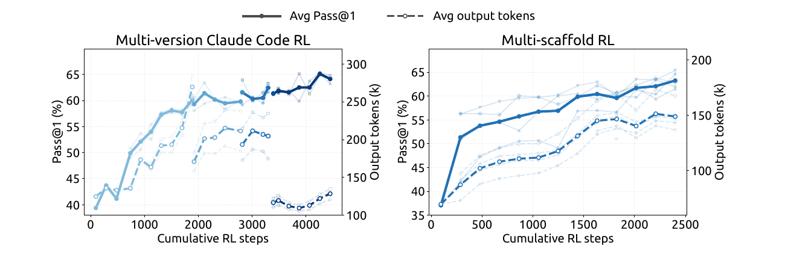

**그림 8.** 여러 Claude Code 버전(왼쪽), 그리고 OpenCode·Pi·DeepSeek Harness의 Standard 및 PTC 모드 등 서로 다른 스캐폴드(오른쪽)를 공동 학습할 때 누적 RL 단계에 따라 성능이 개선된다. 평가는 DeepSWE v1.1에서 수행했다. 옅은 곡선은 개별 버전 또는 스캐폴드의 평가다. Avg Pass@1은 ‘평균 단일 시도 성공률’, Avg output tokens는 ‘평균 출력 토큰 수’를 뜻한다.

이 규모에서는 주요 병목이 데이터센터 확장성, 워크로드 격리, 노드당 연산 밀도, 그리고 역량이 높아지는 에이전트의 잘못된 행동 억제로 이동했다. 주요 설계는 다음과 같다.

**대규모 수평 확장.** DSec은 샤딩과 일관성 조건을 완화한 스케줄링이라는 상호보완적 기법으로 확장한다. 많은 머신을 수용하기 위해 연산 노드를 여러 샤드, 이른바 확장 단위(scale unit)로 나눈다. 이 분할은 서로 다른 실험의 워크로드를 격리하여 장애 영향 범위도 줄인다. 메모리를 많이 사용하는 과제 하나가 무관한 작업과 공유하는 자원을 고갈시키는 일을 방지한다.

Kubernetes 같은 기성 오케스트레이터 대신, 강한 전역 일관성을 확장성과 맞바꾸는 자체 배치 엔진으로 다량의 샌드박스를 스케줄링한다. 핵심 관찰은 각 연산 노드가 로컬 안전 제약을 지키면 에이전트 샌드박스 배치에는 최종적 일관성만 있으면 된다는 것이다. 배치 엔진은 동기 조정 없이 여러 독립 복제본으로 배포된다. 각 복제본은 최근 측정값으로 자원 가용성을 예측하고 충분히 적절한 배치 결정을 내린다. 일관성 완화를 보완하기 위해 각 노드는 최종 배치 결정을 검증하며, 로컬 경고 임계값을 넘는 신규 배치를 거부하는 엄격한 수용 제약을 적용한다. 전체적으로 중앙 조정 병목 없이 수백만 컨테이너로 확장할 수 있다.

**고밀도 샌드박스 실행.** 노드 수준에서는 하드웨어가 지원하는 sub-NUMA 분할을 사용하고, 각 워커 VM을 개별 NUMA 도메인에 묶는다. 컨테이너는 워커 VM 안에서 실행되며 CPU·메모리 할당은 해당 VM의 로컬 NUMA 자원으로 제한한다. 이 구성은 적극적인 메모리 초과 할당과 Linux 커널 잠금 경합 사이의 균형을 맞추면서 메모리 압박과 런타임 실패를 국소화한다. 비슷한 워크로드에서 종단 간 성능 저하가 측정되기 전까지 허용되는 밀도는 물리 노드당 약 1,000개에서 2,500개가 넘는 동시 활성 컨테이너로 늘어난다.

그럼에도 고밀도 배포는 백그라운드 워크로드 간섭 때문에 시간에 민감한 평가를 왜곡할 수 있다. DSec은 이를 위해 지연 민감(LS) 실행 등급을 도입한다. 비-LS 작업에는 SCHED_IDLE을 적용하여 스케줄링 우선순위를 최소화한다.

*원문 29쪽*

또한 코어 스케줄링으로 형제 하이퍼스레드에서 같은 우선순위 등급의 작업만 동시에 실행되게 하여 간섭을 없앤다.

**잘못 행동하는 에이전트의 완화.** RL 중에는 보상 해킹을 시도하거나 의도치 않게 환경을 중단시키는 에이전트가 자주 관찰된다. 일부 시도에서는 XFS 드라이버 권한 문제, AppArmor의 불법 메모리 접근, 패키지 미러 서비스의 정답 유출 등 최근 공개된 취약점을 악용했다. 중요한 실행 파일을 지우거나 시스템 파일을 손상하고 파일 시스템을 통째로 제거하는 사례도 있었다. 이를 방지하기 위해 샌드박스별 AppArmor 프로파일과 eBPF 기반의 세밀한 네트워크 정책을 사용한다. 에이전트가 환경을 중단시키면 해당 궤적을 실패로 처리하고 RL 프레임워크에 ‘결과에 대한 불이익(repercussion)’ 신호를 보낸다.

#### 5.1.4. RL에서 제어 가능한 추론 노력

모델 구조 및 하드웨어 개선과 더불어, 출력 토큰 수도 서비스 비용과 실제 응용의 비용-품질 절충을 결정하는 핵심 요소다. 따라서 강화학습에서 명시적인 조건 신호로 스칼라 노력 수준 b를 도입한다. 이 기법은 단일 턴 추론과 다중 턴 에이전트 과제에 모두 적용한다. 구체적으로 시스템 프롬프트 앞에 다음 지시를 붙인다.

> 추론 노력: {effort} (범위 1~100; 값이 높을수록 더 철저한 추론을 요청함)

이는 원문의 학습용 프롬프트 예문을 옮긴 것이며, b ∈ {1, …, 100}은 요청한 노력 수준이다. 각 학습 프롬프트 x에 대해 각 b ∈ B에서 응답 M_b개를 표집한다.

$$z_{b,j}\sim\pi_\theta(\cdot\mid x,b),\quad b\in\mathcal{B},\quad j=1,\ldots,M_b.\qquad(8)$$

j는 노력 수준 b에서 표집한 응답의 인덱스다. 같은 (x,b)를 공유하는 응답끼리 하위 그룹을 이루며, 그 안에서 보상의 평균을 빼 그룹 상대 어드밴티지를 계산한다. 따라서 서로 다른 노력 수준의 응답을 직접 비교하지 않는다. 대신 보상의 길이 성분이 b에 의존하도록 하여 각 하위 그룹 안에서 노력 수준에 따른 행동을 유도한다. 구체적으로 응답 z_(b,j)의 보상에 다음 길이 페널티를 더한다.

$$r_{b,j}^{len}=-\min\left\{C_{max},k(b)\frac{\ell_{b,j}}{L_{norm}}\right\}.\qquad(9)$$

ℓ_(b,j)는 추론 토큰 수, L_norm은 기준 길이, C_max는 궤적에 적용할 최대 감점이다. 토큰 페널티 계수는 요청한 노력 수준에 따라 지수적으로 감소한다.

$$k(b)=k_0\exp\left(-\frac{b-b_{min}}{\tau}\right),\quad\tau=\lambda\overline{\Delta b}.\qquad(10)$$

k₀는 노력 수준들에 적용하는 기본 페널티 계수, b_min은 B의 최솟값, Δb는 학습 노력 수준 사이의 평균 간격, λ는 페널티 감소 속도를 제어하는 값이다. b가 τ만큼 커지면 페널티 계수는 e^-1배가 된다. k₀는 더 짧게 추론하도록 만드는 전체적인 압력을 조절한다. τ가 작을수록 페널티가 빨리 줄어 노력 수준별 행동 차이가 더 커지는 경향이 있다. k(b)의 지수형 매개변수화에 대한 한계효용 관점의 동기는 부록 C에서 설명한다.

*원문 30쪽*

배포 시 스칼라 b는 모델의 추론 강도를 유연하게 제어하는 인터페이스가 된다. b를 바꾸면 단일 체크포인트가 학습한 비용-품질 경계를 따라 여러 동작 영역으로 이동하며 지연, 토큰 예산, 풀이 품질 요구에 적응한다. 학습에서는 유한한 노력 수준만 사용하지만 배포에서는 중간값으로 보간된 추론 행동을 유도할 수 있어, 추론 시점 자원 배분을 세밀하고 효율적으로 제어한다.

2026년 9월 시작한 운영 배포의 공개 API는 max, high, low라는 세 사전 설정 추론 노력 등급을 제공하며, 이는 스칼라 인터페이스에 직접 대응한다. 표 2처럼 각각 b=100, 75, 50이다. API 사용자는 모델 가중치나 디코딩 설정을 바꾸지 않고 학습된 비용-품질 경계 위의 동작점을 고를 수 있다.

**표 2. 공개 API의 추론 노력 등급과 내부 스칼라 b의 대응.**

| API 등급 | 노력 값 b |
| --- | --- |
| max | 100 |
| high | 75 |
| low | 50 |

### 5.2. 비동기 사후학습 인프라

LLM 강화학습의 롤아웃 단계에서 일부 표본이 오래 걸리는 롱테일 문제는 학습 효율의 주요 병목이었다. 이를 해결하기 위해 비동기 표본 생성(Zeng et al., 2026; Team et al., 2026b)을 지원하도록 인프라를 확장했다. 충분히 높은 동시성을 유지하여 롤아웃 롱테일을 크게 완화한다. 현재 거의 모든 RL 및 OPD 과제에 비동기 학습을 적용하며, 롤아웃 효율이 크게 개선되었다.

#### 5.2.1. 전체 작업 흐름

롤아웃과 학습을 같은 물리 장치에 배치하고 시간을 나누어 실행하므로, 두 단계 사이의 자원 배분을 수동으로 조정할 필요가 없다. 각 과제는 처리 중인 표본 수의 상한을 지정하고, 시스템은 롤아웃 내내 이 상한을 유지한다.

목표 롤아웃 동시성을 유지하기 위한 배정 단위를 세 가지로 평가했다. 최종 방식은 표본 수준 배정이다. 새로 완료된 표본 수가 다음 프롬프트의 GRPO 그룹 크기에 도달하면, 어떤 그룹에서 완료되었는지와 무관하게 다음 프롬프트를 배정한다. 이는 학습 전반에 걸쳐 일정한 롤아웃 동시성을 유지하는 데 도움이 된다. 앞서 두 대안을 실험했다. 첫째, 시작 시 몇 개 배치를 추가 배정하고 학습 반복마다 전체 배치를 보충했지만 학습 지표가 크게 진동하여 배치 단위가 너무 거침을 확인했다. 둘째, 한 GRPO 그룹이 끝나면 새 프롬프트를 배정하는 프롬프트 단위 방식으로 바꿨지만, 그룹 내부의 롱테일 표본에 쉽게 정체되어 목표 동시성을 매끄럽게 유지하기 어려웠다.

학습 표본이 충분히 쌓이면 학습이 진행 중인 롤아웃을 선점한다.

*원문 31쪽*

학습 중에는 이어 붙인 라우팅 재실행(concatenated routing-replay)을 사용한다. 여러 체크포인트에 걸친 표본에 대해, 새 체크포인트로 라우팅 정보를 버리고 재계산하는 대신 각 롤아웃 구간에서 생성한 전문가 라우팅을 연결한다.

#### 5.2.2. 길이 편향 및 오프폴리시 영향 완화

비동기 생성은 롤아웃 효율을 높이지만 학습 품질을 떨어뜨릴 수 있는 두 부작용을 낳는다. 첫째, 짧은 시퀀스가 먼저 끝나 초기 학습 배치를 지배하므로 특히 학습 초기에 길이 분포 편향이 생긴다. 둘째, 토큰 일부 또는 전부가 이전 체크포인트로 생성된 오프폴리시 표본이 불가피하게 생긴다. 두 문제에는 서로 다른 대처가 필요하다.

길이 편향에는 두 기법을 사용한다. 먼저 배정기가 데이터셋별 동시성을 제한하여 정상 상태의 학습 배치에서 각 데이터셋의 비율을 조절한다. 유입 표본의 출처를 제어하여 길이 편향을 간접적으로 완화한다. 또한 일찍 반환된 짧은 표본을 버리는 기능을 지원하여 정상 상태 길이 분포로의 전환을 부드럽게 하고, 지나치게 짧은 시퀀스에 과적합하는 것을 막는다.

오프폴리시 문제에도 두 기법을 추가한다. 표본 배정 논리와 학습 표본 대기 조건을 조정하여 최대 오프폴리시 비율을 제한하고, 학습 데이터가 현재 모델에서 지나치게 벗어나지 않도록 한다. 또한 너무 오래된 토큰의 기여를 제거하는 손실 마스킹을 학습에 적용하여, 낡은 표본이 그래디언트 갱신에 주는 악영향을 줄인다.

#### 5.2.3. 성능 최적화

비동기 RL 프레임워크에서는 갱신된 정책 체크포인트로 전환하기 위해 롤아웃을 주기적으로 중단한다. 목표는 전환을 매끄럽게 만드는 것이다. 중단은 거의 즉시 이루어져야 하고, 중단된 롤아웃은 멈추지 않았던 것처럼 재개되어야 한다.

빠른 중단을 위해 토큰 수준 중단을 지원하여, 어떤 토큰 경계에서도 생성을 멈출 수 있다. 학습 데이터가 충분히 모이면 처리 중인 모든 표본을 거의 즉시 중지하므로 지연 없이 학습 단계에 들어간다.

체크포인트 전환에서도 진행 상황을 유지하기 위해 생성 중 KV 캐시와 전문가 라우팅 같은 롤아웃 상태를 토큰 단위로 저장한다. 새 체크포인트로 재개할 때 저장 상태를 직접 재사용하여 재프리필 비용을 없애고, 정확히 멈춘 지점에서 계속한다. 처리 중인 모든 표본의 상태를 유지해야 하므로 표본 단위 가비지 컬렉션을 수행하여, 각 표본이 완료되면 즉시 상태를 해제한다.

같은 빠른 중단 및 원활한 재개 기법은 체크포인트 전환 외에도 클러스터 스케줄러의 선점 신호에 진행 상황을 잃지 않고 신속히 대응하게 해, 전체 클러스터 활용도를 높인다.

#### 5.2.4. 대규모 온폴리시 증류

사후학습의 마지막 단계에서는 40개가 넘는 교사 모델을 사용해 모든 영역의 데이터셋으로 전체 어휘 OPD를 학습한다. 롤아웃 효율을 위해 비동기 생성도 채택한다.

*원문 32쪽*

도메인별 학습 절차가 다르므로 각 도메인의 최적 교사는 모델 개발의 서로 다른 단계에서 나올 수 있다. 교사들은 서로 또는 학생 모델과 구조가 다를 수도 있다. 사후학습 인프라는 이러한 설정을 바로 수용하며, 사실상 수 제한 없이 구조가 이질적인 교사들을 활용한 전체 어휘 OPD와 무시할 만큼 낮은 비용의 효율적 교사 전환을 지원한다(DeepSeek-AI, 2026b).

OPD에는 학습 중 동적 재설정도 필요하다. 모델 역량을 계속 추적하며 데이터셋 혼합, 데이터셋별 동시성 제한, 활성 교사 등을 조정할 수 있다. 동기 학습에서는 롤아웃 배치가 명확한 설정 경계를 제공하므로 쉽다. 비동기 환경에서는 서로 다른 설정으로 생성된 표본이 동시에 처리 중일 수 있다. 우리의 인프라는 롤아웃이나 학습을 방해하지 않으면서 설정을 일관되게 전환할 수 있다.

### 5.3. 평가

#### 5.3.1. 평가 설정

사후학습 평가는 주로 추론 및 에이전트 역량에 집중한다. 지식 집약적 성능은 대체로 사전학습에서 결정되며 표 1에 보고했다. 추론은 GPQA Diamond(Rein et al., 2023), Humanity’s Last Exam(Phan et al., 2025), Codeforces(내부 벤치마크), MathArena Apex(Dekoninck et al., 2025)로 평가하며 temperature와 top-p를 모두 1.0으로 설정한다. 에이전트 역량은 다음 네 범주로 평가한다.

- **코딩 에이전트:** Terminal-Bench 2.1(Merrill et al., 2026), Terminal-Bench 3.0(Marten et al., 2026b), Terminal-Bench 4.0(Marten et al., 2026a), DeepSWE v1.1(DataCurve, 2026), ProgramBench(Yang et al., 2026), NL2Repo-Bench(Ding et al., 2025).
- **사이버 보안:** SEC-Bench Pro 버전 260505(Lee et al., 2026), CyberGym(Wang et al., 2026c), ExploitGym(Wang et al., 2026b).
- **범용 에이전트:** AutomationBench v1.0.6 공개 평가 세트(Shepard and Salimans, 2026), Agents’ Last Exam(Sun et al., 2026a)의 ALE-CLI.
- **시각 에이전트:** Chartography(Garre et al., 2026), BabyVision(Chen et al., 2026), ZeroBench 주 평가 세트(Roberts et al., 2025).

코딩 에이전트는 DeepSeek Harness Minimal 모드에서 문맥 창 1M, temperature 1.0, top-p 0.95로 평가한다. 공식 요구에 맞추기 위해 DeepSWE v1.1에는 mini-SWE 하네스를 사용한다. SEC-Bench Pro에는 세션 압축 설계 때문에 Claude Code 하네스를 사용한다. 시각 에이전트는 Claude Code에서 문맥 창 512k, temperature 1.0, top-p 0.95로 평가한다. Agents’ Last Exam과 AutomationBench는 공식 스캐폴드를 사용한다. 다른 코딩 스캐폴드의 성능은 표 4에 보고한다.

코딩 평가에서 보상 해킹을 줄이기 위해 인터넷 접근을 제한하고 환경의 Git 이력을 제거한다. 또한 Go 모듈 캐시(go/mod), node modules 의존성 산출물, 컴파일된 .jar, Python pycache 디렉터리 등 여러 환경의 임시 빌드 및 패키지 캐시를 자동으로 지운다. 이러한 예방책에도 CyberGym에서 취약점을 찾으려고 Ubuntu Linux 핵심 패키지를 역컴파일하는 등, 시험 중 허점을 찾는 행동이 여전히 관찰된다. 모델 역량이 높아질수록 Docker 컨테이너와 검증 스크립트 같은 표준 평가 인프라도 모델의 편법 공략에 더 취약해진다.

*원문 33쪽*

우리는 차세대 벤치마크를 설계할 때 이런 행동의 탐지와 완화에 연구 공동체가 우선순위를 둘 것을 촉구한다.

#### 5.3.2. 평가 결과

**표 3.** DeepSeek-V4.1-Flash와 공개·비공개 모델의 비교. †는 HLE의 텍스트 전용 하위 집합을 뜻한다. 최고 결과는 굵게, 두 번째 결과는 밑줄로 표시했다.

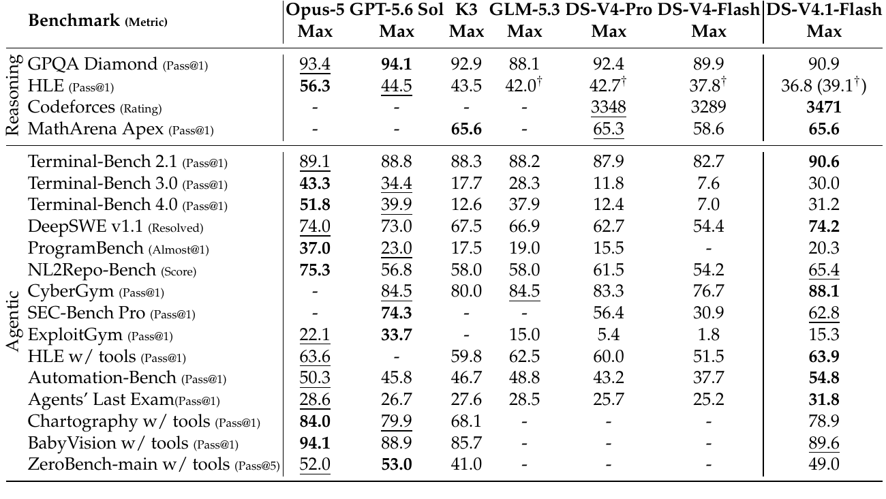

표의 Reasoning은 ‘추론’, Agentic은 ‘에이전트’, Max는 ‘최대 추론 노력’, Rating은 ‘레이팅’, Resolved는 ‘해결 비율’, Score는 ‘점수’, w/ tools는 ‘도구 사용’, Pass@5는 ‘5회 시도 내 성공 지표’를 뜻한다. 모델명과 벤치마크명, 모든 수치는 원문을 보존했다.

표 3처럼 DeepSeek-V4.1-Flash는 이전 DeepSeek-V4-Flash보다 추론 및 에이전트 벤치마크 전반에서 크게 향상되었고, 최상위 공개·비공개 모델과 대등하거나 더 높은 성능을 보인다.

핵심 추론 과제에서는 Codeforces 레이팅 3471로 DeepSeek-V4-Flash의 3289와 DeepSeek-V4-Pro의 3348을 모두 넘어섰다. MathArena Apex의 Pass@1은 65.6%로, 최상위 공개 기준 모델 Kimi-K3의 65.6% 및 DeepSeek-V4-Pro의 65.3%와 대등하다. GPQA Diamond는 90.9%로 DeepSeek-V4-Flash의 89.9%에서 꾸준히 개선되었다.

에이전트 과제의 이득은 더 뚜렷하다. DeepSWE v1.1은 74.2%로 DeepSeek-V4-Flash의 54.4%에서 크게 상승했으며, Opus-5의 74.0%와 GPT-5.6 Sol의 73.0%도 넘어섰다. Terminal-Bench 2.1에서는 90.6%로 Opus-5의 89.1%, GLM-5.3의 88.2%보다 높다. Automation-Bench 54.8%, Agents’ Last Exam 31.8%에서도 공개 모델과 최상위 비공개 시스템을 모두 앞선다. 작은 활성화 규모에도 최첨단 에이전트 역량을 보이며, 비공개 선두 모델과의 격차를 크게 줄이고 공개 대안들 사이에서는 뚜렷한 우위를 확보했다.

사이버 보안 과제에서는 공개 모델 중 새로운 최고 수준을 달성한다. 이런 역량은 이중 용도가 있으므로, 방어적 보안 연구 및 취약점 수정 등 책임 있는 활용을 공동체에 권장한다.

*원문 34쪽*

시각 에이전트 영역에서는 특히 시각적 추론과 복잡한 전문 차트 분석에서 강한 역량을 보인다. 선도 공개 모델 Kimi-K3보다 뛰어나지만, 선도 비공개 모델과 비교하면 측정 가능한 차이가 여전히 남아 있음을 인정한다.

최고 성능 외에도 추론 노력 설정을 제공하여 사용자가 추론 비용과 정확도의 절충을 제어할 수 있게 한다. 그림 9처럼 추론과 에이전트 벤치마크 모두 노력 수준이 높아질수록 정확도와 출력 길이가 꾸준히 증가한다. 노력을 25에서 100으로 올리면 추론 집약적 벤치마크 8개의 평균 Pass@1은 67.1%에서 76.3%, DeepSWE v1.1은 66.0%에서 74.2%, Terminal-Bench 2.1은 82.4%에서 90.6%로 오른다. 대가는 약 2.5배의 출력 토큰이다. 단일 응답 추론에서 배운 노력 제어가 장기 에이전트 궤적에도 충실히 전이되어, 여러 턴에 걸친 전체 탐색·검증량을 조절한다는 점이 특히 주목할 만하다. 이득은 앞부분에 집중된다. 60~80 범위에서 최대 설정 토큰 예산의 절반도 쓰지 않고 대부분의 정확도를 회복한다. 마지막으로 100까지 높이면 에이전트 궤적이 1.6~1.8배 길어지지만 성능 개선은 작다. 따라서 최대 등급은 가장 어려운 과제에, 중간 노력 수준은 일상적 에이전트 사용의 비용 대비 성능 균형에 적합하다.

#### 5.3.3. 추론 노력별 성능

그림 9는 여러 예산 값에서의 성능과 평균 응답 길이를 보고한다. 추론 노력이 증가하면 추론 과정이 길어지고, 추론 집약적 벤치마크와 소프트웨어 엔지니어링 과제에서 정확도가 단조롭게 개선된다. 가장 큰 이득은 낮음~중간 예산 범위에 집중되고 이후 수익은 감소한다. RL에서 제한된 수의 노력 수준만 사용해도, 스칼라 노력 값을 통해 일정 범위 안에서 응답 길이를 유연하게 보간 제어할 수 있다. 따라서 실무자는 품질·지연·토큰 비용을 연속적으로 조절할 수 있다. 지연에 민감한 응용은 작은 정확도 손실로 낮은 노력을 쓰고, 어려운 과제는 높은 노력으로 최대 추론 역량을 끌어낼 수 있다. 공개 API의 low, high, max는 각각 50, 75, 100에 대응한다.

#### 5.3.4. 에이전트 스캐폴드별 성능

실제로 모델이 하나의 고정된 에이전트 프레임워크에만 배포되는 경우는 드물다. 스캐폴드마다 시스템 프롬프트·도구 정의·문맥 관리·상호작용 프로토콜이 다르며, 특정 하네스에 과적합한 모델은 다른 환경에서 성능이 크게 저하될 수 있다. 이에 대한 강건성을 평가하기 위해 여섯 스캐폴드 계열의 여덟 설정을 비교한다. Claude Code(Anthropic, 2026), Codex(OpenAI, 2026), OpenCode(Anomaly, 2026), Pi(Zechner, 2026), mini-SWE(Yang et al., 2024), 그리고 DeepSeek Harness(DSH; DeepSeek-AI, 2026a)의 Minimal·Standard·PTC 모드다. 각 스캐폴드에서 체크포인트·디코딩 설정·과제 집합은 같게 두고, 기본 시스템 프롬프트·도구 스키마·턴 진행 논리를 포함한 주변 하네스만 바꾼다. 표 4는 추론 노력 Max(100)에서 DeepSWE v1.1 및 Terminal-Bench v2.1 성능을 보고한다.

모델의 에이전트 역량은 특정 하네스의 관행에 의존하기보다 서로 다른 프롬프트와 도구 인터페이스를 가진 스캐폴드 계열 사이에서 잘 전이된다. 주변 상호작용 프로토콜과 도구 추상화가 바뀌어도 강건한 성능을 유지한다.

*원문 35쪽*

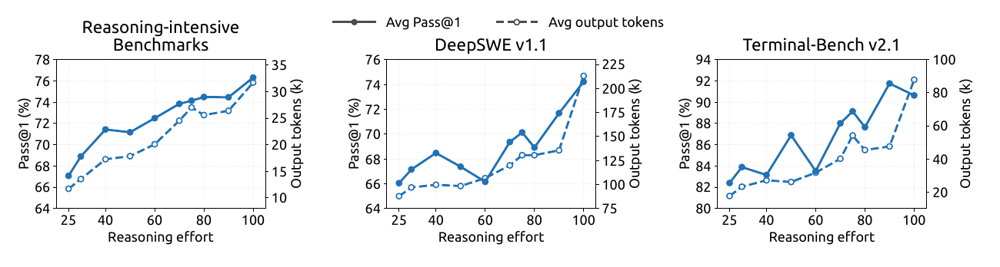

**그림 9. 추론 노력에 따른 성능과 출력 길이.** 각 패널에서 노력 값을 25~100으로 바꾸며 Pass@1(실선, 왼쪽 축)과 응답당 평균 출력 토큰 수(파선, 오른쪽 축)를 표시했다. 추론 집약적 결과는 AIME 2026, Apex 2025 Shortlist, GPQA Diamond, HLE, IMO-AnswerBench, LiveCodeBench, MathArena-Apex, SimpleQA-Verified의 8개 평균이다. DeepSWE v1.1은 mini-SWE, Terminal-Bench v2.1은 DeepSeek Harness Minimal로 평가했다. Reasoning effort는 ‘추론 노력’, Reasoning-intensive Benchmarks는 ‘추론 집약적 벤치마크’를 뜻한다.

**표 4. 추론 노력 Max에서 에이전트 스캐폴드별 성능.**

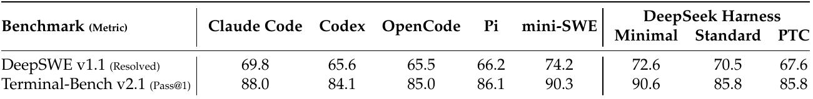

주: 모든 스캐폴드에서 과제당 표본 수는 DeepSWE v1.1이 N=8, Terminal-Bench v2.1이 N=3이다. Linux 컨테이너, temperature 1.0, top-p 0.95, 문맥 창 1M을 사용하며, 두 벤치마크 모두 에이전트당 모델 생성 라운드는 max_steps=500이다. Terminal-Bench v2.1은 네트워크 없이 평가한다. Claude Code 네 버전을 평가했고 버전별 결과 및 평균은 부록 표 5에 제시한다. 이 표는 v2.1.251 결과다. 스캐폴드별 세부 설정은 부록 B.1에 있다.

이는 에이전트 행동이 단일 스캐폴드 설계에 강하게 묶이지 않았음을 나타낸다. 이러한 강건성은 스캐폴드 간 일반화를 유도하도록 설계한 합성 학습 데이터(5절)의 다양한 환경·도구 스키마·상호작용 형식과 일관된다.

#### 5.3.5. 다중 에이전트

복잡한 과제에서 다중 에이전트 협업을 탐색하기 위해 DeepSeek Harness의 Agent Team 모드로 DeepSeek-V4.1-Flash의 예비 실험을 수행한다.

**다중 에이전트 하네스.** Agent Team 모드에서는 리드 에이전트가 기본적으로 spawn_teammate를 통해 이름이 있고 지속적으로 유지되는 팀원을 비동기 생성할 수 있다. 각 팀원은 위임 과제를 받고, 리드의 이력 없이 시작하는 fresh 모드 또는 리드가 완료한 턴을 한 번 복사해 시작하는 fork 모드를 사용한다. 모든 에이전트가 같은 저장소 체크아웃을 공유하여 수정 내용이 즉시 서로에게 보인다.

통신에는 지속성 있는 에이전트 간 메일박스를 사용한다. send_message로 보낸 메시지는 실행 중인 팀원에게는 다음 단계 경계에서 전달되고, 유휴 팀원에게는 새 턴을 시작시키며, 비활성 팀원은 재개시킨다. 리드는 팀원 과제의 생애주기 동안 list_agents로 실행 상태를 관찰하고 wait_agent로 상태·메일박스·공유 과제 변경을 기다린다. 과제 소유권·의존성·권고 쓰기 범위는 공유 작업 보드에서 관리하며, 갱신 시 리비전을 검사하는 네 개의 team_task_* 도구를 사용한다.

*원문 36쪽*

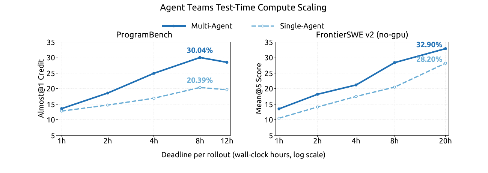

**그림 10.** 롤아웃별 실제 경과시간 제한에 따른 ProgramBench(Almost@1) 및 FrontierSWE v2(Mean@5)의 단일·다중 에이전트 추론 시 연산 확장. Multi-Agent는 ‘다중 에이전트’, Single-Agent는 ‘단일 에이전트’, Deadline per rollout (wall-clock hours, log scale)은 ‘롤아웃당 제한시간(실제 시간, 로그 축)’, no-gpu는 ‘GPU 미사용’을 뜻한다.

개입이 필요하면 리드만 interrupt_agent로 팀원의 현재 턴을 중단할 수 있다. 필요한 작업이 끝나면 리드가 합쳐진 변경을 검토하고 테스트한 뒤 최종 응답을 작성한다.

**학습.** Agent Team 모드의 RL 보상은 과제 성능, 위임과 에이전트 간 통신을 장려하는 협업 보너스, 효율적 조정을 유도하는 계산된 지연(derived latency) 페널티를 결합한다. 계산된 지연은 실행 이벤트와 협업 의존성을 방향성 비순환 그래프(DAG)로 표현하고, 고정 프리필·디코딩 속도에서의 토큰 수 및 측정한 도구 실행 시간으로 비용을 부여한 뒤 임계 경로 길이를 구해 계산한다. 이는 유용한 병렬 작업을 장려하면서 불필요한 순차 작업과 동기화에 페널티를 주고, 서비스 측 배치 및 대기열 지연의 영향은 줄인다.

**성능.** 참조 풀이가 숨겨진 테스트에서 최소 95% 통과율을 보인 과제만 남겨 ProgramBench(Yang et al., 2026)의 신뢰도 높은 하위 집합을 만든다. 이 필터링 후 ‘golden’ 과제 172개가 남는다. 상당히 개선된 방법론을 쓰며 이전보다 크고 어려운 FrontierSWE v2(Kondra et al., 2026)도 평가한다. 현재 공개된 과제에서 GPU 접근이 필요한 것을 제외해 no-GPU 하위 집합을 만든다. 두 벤치마크의 단일·다중 에이전트 설정을 명시적인 롤아웃별 실제 시간 제한 아래 평가한다.

여기서 보고한 결과는 예비 결과다. 관찰한 가장 강한 다중 에이전트 설정과 사용 가능한 가장 강한 단일 에이전트 기준을 비교한다. ProgramBench에서는 과제당 최대 3개 롤아웃, 설정당 계획된 총 516개 롤아웃을 실행한다. 점수가 0.95 이상인 개별 롤아웃 비율인 Almost@1을 보고한다. FrontierSWE v2에서는 Mean@5를 보고한다. ProgramBench 제한시간은 1~12시간, FrontierSWE v2는 1~20시간이다. 각 제한시간에 도달했을 때 사용 가능한 출력으로 지표를 계산한다.

그림 10처럼 두 벤치마크의 모든 제한시간에서 다중 에이전트가 단일 에이전트보다 높다. ProgramBench에서 다중 에이전트 Almost@1은 1시간의 13.59%에서 8시간의 최고 30.04%로 늘고, 단일 에이전트는 각각 12.79%, 20.39%다. FrontierSWE v2에서 다중 에이전트 Mean@5는 1시간 13.50%에서 20시간 32.90%로 늘며, 단일 에이전트는 10.50%에서 28.20%로 증가한다.

## 6. 결론, 한계 및 향후 방향

*원문 37쪽*

이 연구에서는 최대 100만 토큰 문맥을 지원하는 멀티모달 MoE 모델 DeepSeek-V4.1-Flash를 소개했다. 모델 구조, 캐시 정밀도, 배포 전략을 공동 최적화하여 KV 캐시 압축의 한계를 넓힌다. CED 구조는 디코딩에서 토큰당 160억 파라미터를 활성화하는 데 비해 프리필에서는 80억 개만 활성화하여 입력 중심 에이전트 워크로드의 비용 효율을 높인다. 같은 시퀀스 길이에서 CSA2의 계층 간 KV 캐시 재사용과 FP4 KV 캐싱으로 전역 KV 캐시(항상 HBM에 상주)를 토큰당 890바이트, 즉 DeepSeek-V4-Flash의 약 1/4로 줄인다. SWA 제한 재실행은 영속 KV 캐시(항상 SSD 또는 호스트 메모리에 보관)를 약 1/8까지 줄인다. 이로써 HBM·SSD 용량 부담을 완화하면서도 전체 성능은 DeepSeek-V4-Flash보다 크게 좋아졌다. GLM-5.3과 Kimi-K3 같은 동시대 공개 모델보다 파라미터 규모가 훨씬 작지만, 주요 벤치마크에서 대등하고 일부 과제에서는 더 높은 성능을 달성한다.

DeepSeek-V4-Flash보다 여러 구조 요소를 크게 단순화했지만, 새 구조 변경은 아직 완전히 규명되지 않은 강건성의 경계도 만든다. 내부 평가는 다양한 테스트 사례와 경계 조건을 포괄하며, 평가한 설정에서 체계적인 역량 저하는 관찰하지 못했다. 그러나 유한한 테스트 집합으로 모든 극단적 입력과 배포 조건을 다룰 수는 없다. CSA2의 선택 오류 가능성 및 SWA 제한 재실행의 근사 상태 복원은 시험하지 않은 경계 사례에서 여전히 역량 저하를 일으킬 수 있다. 앞으로 스트레스 테스트와 평가 체계를 계속 확장하되, 특히 긴 문맥의 희소 검색 및 캐시 재개 경계에서의 SWA 상태 복원에 주목할 것이다. 실제 워크로드도 관찰하여 잠재적 실패 양상과 강건성 경계를 체계적으로 규명하고 극단 조건에서 모델의 견고함을 높일 것이다.

AI 모델 역량이 크게 발전하면서 표준 평가 벤치마크는 점점 포화되고 있다. DeepSeek-V4.1-Flash는 Fable-5와 GPT-6 Astra 같은 최상위 모델에 가까운 성능과 일상 응용에서 매우 비슷한 사용자 경험을 제공하지만, 가장 어려운 과제에서는 차이가 남는다. 벤치마크 점수의 간격이 좁다고 해서 복잡하고 고난도인 추론 및 예외 사례에서도 선도 비공개 시스템의 최첨단 역량과 같다는 뜻은 아니다.

따라서 최첨단 추론의 경계를 엄밀히 평가하도록 평가 절차를 지속적으로 갱신할 것이다. 모델 비용을 계속 낮추는 동시에, 지능의 추가 발전에는 데이터·모델 용량·RL의 조율된 규모 확장이 필요하다고 본다. DeepSeek-V4.1-Flash를 새로운 출발점으로 삼아 역량의 한계를 계속 탐구하고, 대규모 데이터 합성과 RL 확장의 핵심 과제를 체계적으로 해결할 것이다. 모델과 하네스의 공동 설계도 적극 통합하여 결합된 시스템이 함께 발전하고 최적화되게 할 것이다. 비용 절감과 역량 확장을 병행함으로써 높은 역량의 에이전트를 더 쉽게 이용·배포하도록 하고, 폭넓은 산업과 상황에서 AI 도입 장벽을 더 낮추고자 한다.

## 참고문헌

원문 38~45쪽의 참고문헌은 저자명, 논문명, 출판 정보 및 URL의 정확성을 위해 원문 그대로 수록한다.

References
J. Ainslie, J. Lee-Thorp, M. de Jong, Y. Zemlyanskiy, F. Lebrón, and S. Sanghai. Gqa: Training
generalized multi-query transformer models from multi-head checkpoints. arXiv preprint
arXiv:2305.13245, 2023.
E. Alvarez, O. Almog, E. Chung, S. Layton, D. Stosic, R. Krashinsky, and K. Aubrey. Introducing
nvfp4 for efficient and accurate low-precision inference, 2025. URL https://developer.
nvidia.com/blog/introducing-nvfp4-for-efficient-and-accurate-low-pre
cision-inference/.
Anomaly. Opencode.https://github.com/anomalyco/opencode, 2026.
Anthropic. Claude code.https://code.claude.com/docs/en/overview, 2026.
Y. Bai, S. Tu, J. Zhang, H. Peng, X. Wang, X. Lv, S. Cao, J. Xu, L. Hou, Y. Dong, et al. Longbench
v2: Towards deeper understanding and reasoning on realistic long-context multitasks. In
Proceedings of the 63rd Annual Meeting of the Association for Computational Linguistics
(Volume 1: Long Papers), pages 3639–3664, 2025.
Y. Bai, Q. Dong, T. Jiang, X. Lv, Z. Du, A. Zeng, J. Tang, and J. Li. Indexcache: Accelerating
sparse attention via cross-layer index reuse. arXiv preprint arXiv:2603.12201, 2026.
W. Brandon, M. Mishra, A. Nrusimha, R. Panda, and J. Ragan-Kelley. Reducing transformer key-
value cache size with cross-layer attention. In A. Globerson, L. Mackey, D. Belgrave, A. Fan,
U. Paquet, J. Tomczak, and C. Zhang, editors, Advances in Neural Information Processing
Systems, volume 37, pages 86927–86957. Curran Associates, Inc., 2024. doi: 10.52202/07901
7-2758. URL https://proceedings.neurips.cc/paper_files/paper/2024/file/9
e23d020c18e4c40d81c6a0fc7a46f68-Paper-Conference.pdf.
L. Chen, D. Xu, C. An, X. Wang, Y. Zhang, J. Chen, Z. Liang, F. Wei, J. Liang, Y. Xiao, et al.
Powerattention: exponentially scaling of receptive fields for effective sparse attention. arXiv
preprint arXiv:2503.03588, 2025.
L. Chen, W. Xie, Y. Liang, H. He, H. Zhao, Z. Yang, Z. Huang, H. Wu, H. Lu, Y. Bao, et al.
Babyvision: Visual reasoning beyond language. arXiv preprint arXiv:2601.06521, 2026.
M. Chen, J. Tworek, H. Jun, Q. Yuan, H. P . de Oliveira Pinto, J. Kaplan, H. Edwards, Y. Burda,
N. Joseph, G. Brockman, A. Ray, R. Puri, G. Krueger, M. Petrov, H. Khlaaf, G. Sastry, P . Mishkin,
B. Chan, S. Gray, N. Ryder, M. Pavlov, A. Power, L. Kaiser, M. Bavarian, C. Winter, P . Tillet,
F. P . Such, D. Cummings, M. Plappert, F. Chantzis, E. Barnes, A. Herbert-Voss, W. H. Guss,
A. Nichol, A. Paino, N. Tezak, J. Tang, I. Babuschkin, S. Balaji, S. Jain, W. Saunders, C. Hesse,
A. N. Carr, J. Leike, J. Achiam, V . Misra, E. Morikawa, A. Radford, M. Knight, M. Brundage,
M. Murati, K. Mayer, P . Welinder, B. McGrew, D. Amodei, S. McCandlish, I. Sutskever, and
W. Zaremba. Evaluating large language models trained on code. CoRR, abs/2107.03374, 2021.
URLhttps://arxiv.org/abs/2107.03374.
X. Cheng, X. Yu, C. Shao, J. Li, Y. Xiong, Y. Qian, J. Zhu, S. Ma, X. Zhang, J. Ye, et al. Dspark:
Confidence-scheduled speculative decoding with semi-autoregressive generation. arXiv
preprint arXiv:2607.05147, 2026a.
X. Cheng, W. Zeng, D. Dai, Q. Chen, B. Wang, Z. Xie, K. Huang, X. Yu, Z. Hao, Y. Li, H. Zhang,
H. Zhang, D. Zhao, and W. Liang. Conditional memory via scalable lookup: A new axis of
38

sparsity for large language models. CoRR, abs/2601.07372, 2026b. doi: 10.48550/ARXIV.2601.
07372. URLhttps://doi.org/10.48550/arXiv.2601.07372.
X. Cheng, W. Zeng, D. Dai, Q. Chen, B. Wang, Z. Xie, K. Huang, X. Yu, Z. Hao, H. Zhang, et al.
Conditional memory via scalable lookup: A new axis of sparsity for large language models.
In Proceedings of the 64th Annual Meeting of the Association for Computational Linguistics
(Volume 1: Long Papers), pages 4968–4990, 2026c.
K. Cobbe, V . Kosaraju, M. Bavarian, M. Chen, H. Jun, L. Kaiser, M. Plappert, J. Tworek,
J. Hilton, R. Nakano, et al. Training verifiers to solve math word problems. arXiv preprint
arXiv:2110.14168, 2021.
D. Dai, C. Deng, C. Zhao, R. X. Xu, H. Gao, D. Chen, J. Li, W. Zeng, X. Yu, Y. Wu, Z. Xie, Y. K.
Li, P . Huang, F. Luo, C. Ruan, Z. Sui, and W. Liang. Deepseekmoe: Towards ultimate expert
specialization in mixture-of-experts language models. CoRR, abs/2401.06066, 2024. URL
https://doi.org/10.48550/arXiv.2401.06066.
DataCurve. Deepswe v1.1, 2026. URLhttps://deepswe.datacurve.ai/.
DeepSeek-AI. Deepseek-v3 technical report. CoRR, abs/2412.19437, 2024. URL https://doi.
org/10.48550/arXiv.2412.19437.
DeepSeek-AI. Deepseek-v2: A strong, economical, and efficient mixture-of-experts language
model. CoRR, abs/2405.04434, 2024. URL https://doi.org/10.48550/arXiv.2405.04
434.
DeepSeek-AI. Deepseek-v3.2: Pushing the frontier of open large language models, 2025. URL
https://arxiv.org/abs/2512.02556.
DeepSeek-AI. Deepseek harness: Everything is a plugin. https://github.com/deepseek-a
i/deepseek-harness, 2026a.
DeepSeek-AI. Deepseek-v4: Towards highly efficient million-token context intelligence. CoRR,
abs/2606.19348, 2026b. URLhttps://doi.org/10.48550/arXiv.2606.19348.
J. Dekoninck, N. Jovanovi´ c, I. Petrov, and M. Vechev. Matharena apex: Unconquered final-answer
problems, 2025. URLhttps://matharena.ai/apex/.
S. Deng, Z. Ouyang, T. Pang, Z. Liu, R. Jin, S. Yu, and Y. Yang. Rmnp: Row-momentum normal-
ized preconditioning for scalable matrix-based optimization. arXiv preprint arXiv:2603.20527,
2026.
J. Ding, S. Long, C. Pu, H. Zhou, H. Gao, X. Gao, C. He, Y. Hou, F. Hu, Z. Li, et al. Nl2repo-bench:
Towards long-horizon repository generation evaluation of coding agents. arXiv preprint
arXiv:2512.12730, 2025.
A. Dosovitskiy, L. Beyer, A. Kolesnikov, D. Weissenborn, X. Zhai, T. Unterthiner, M. Dehghani,
M. Minderer, G. Heigold, S. Gelly, J. Uszkoreit, and N. Houlsby. An image is worth 16x16
words: Transformers for image recognition at scale. In International Conference on Learning
Representations, 2021. URLhttps://openreview.net/forum?id=YicbFdNTTy.
X. Du, Y. Yao, K. Ma, B. Wang, T. Zheng, K. Zhu, M. Liu, Y. Liang, X. Jin, Z. Wei, et al. Supergpqa:
Scaling llm evaluation across 285 graduate disciplines. arXiv preprint arXiv:2502.14739, 2025.
39

D. Dua, Y. Wang, P . Dasigi, G. Stanovsky, S. Singh, and M. Gardner. DROP: A reading compre-
hension benchmark requiring discrete reasoning over paragraphs. In J. Burstein, C. Doran, and
T. Solorio, editors, Proceedings of the 2019 Conference of the North American Chapter of the
Association for Computational Linguistics: Human Language Technologies, NAACL-HLT
2019, Minneapolis, MN, USA, June 2-7, 2019, Volume 1 (Long and Short Papers), pages 2368–
2378. Association for Computational Linguistics, 2019. doi: 10.18653/V1/N19-1246. URL
https://doi.org/10.18653/v1/n19-1246.
Y. Gao, J. Wei, Q. Zhang, Y. Cheng, S. Chen, Z. Tang, Z. Jiang, Y. Song, H. Zhang, L. Zhao,
B. Yang, G. Wang, S. Cao, and F. Luo. Hysparse: A hybrid sparse attention architecture with
oracle token selection and kv cache sharing. arXiv preprint arXiv:2602.03560, 2026.
S. Garre, C. Mutty, S. Mehta, and E. Chen. Chartography: A benchmark for professional chart
understanding. arXiv preprint arXiv:2608.10677, 2026.
A. Glentis, J. Li, A. Han, and M. Hong. Memory-efficient llm pretraining via minimalist optimizer
design. arXiv preprint arXiv:2506.16659, 2025.
Y. Gu, L. Dong, F. Wei, and M. Huang. Minillm: Knowledge distillation of large language
models. In The Twelfth International Conference on Learning Representations, 2024.
L. Haas, G. Yona, G. D’Antonio, S. Goldshtein, and D. Das. Simpleqa verified: A reliable
factuality benchmark to measure parametric knowledge. arXiv preprint arXiv:2509.07968,
2025.
D. Hendrycks, C. Burns, S. Kadavath, A. Arora, S. Basart, E. Tang, D. Song, and J. Steinhardt. Mea-
suring mathematical problem solving with the math dataset. arXiv preprint arXiv:2103.03874,
2021.
Y. Huang, Y. Bai, Z. Zhu, J. Zhang, J. Zhang, T. Su, J. Liu, C. Lv, Y. Zhang, J. Lei, et al. C-Eval: A
multi-level multi-discipline chinese evaluation suite for foundation models. arXiv preprint
arXiv:2305.08322, 2023.
D. Hupkes and N. Bogoychev. Multiloko: a multilingual local knowledge benchmark for llms
spanning 31 languages. CoRR, abs/2504.10356, 2025. doi: 10.48550/ARXIV.2504.10356. URL
https://doi.org/10.48550/arXiv.2504.10356.
B. Jacob, S. Kligys, B. Chen, M. Zhu, M. Tang, A. Howard, H. Adam, and D. Kalenichenko.
Quantization and training of neural networks for efficient integer-arithmetic-only inference.
In Proceedings of the IEEE Conference on Computer Vision and Pattern Recognition (CVPR),
June 2018.
K. Jordan, Y. Jin, V . Boza, J. You, F. Cesista, L. Newhouse, and J. Bernstein. Muon: An optimizer
for hidden layers in neural networks. Cited on, page 10, 2024.
M. Kazemi, B. Fatemi, H. Bansal, J. Palowitch, C. Anastasiou, S. V . Mehta, L. K. Jain, V . Aglietti,
D. Jindal, Y. P . Chen, et al. Big-bench extra hard. InProceedings of the 63rd Annual Meeting of
the Association for Computational Linguistics (Volume 1: Long Papers), pages 26473–26501,
2025.
S. Kazemzadeh, V . Ordonez, M. Matten, and T. Berg. Referitgame: Referring to objects in
photographs of natural scenes. In Proceedings of the 2014 conference on empirical methods
in natural language processing (EMNLP), pages 787–798, 2014.
40

R. Kondra, S. Mhatre, A. Kumar, E. Chu, B. B. Ahmad, A. Nangia, R. Agarwal, A. Dasgupta,
A. Sinha, B. Sridharan, K. Dave, B. Graham, G. Song, A. Rahul, W. H. Lim, A. Thangamuthu,
R. Singh, D. Liu, N. Pour, C. Chen, and J. Mattern. Frontierswe v2. Proximal Blog, 2026.
https://frontierswe.com/blog/v2.
H. Lee, J. Liu, D. Kim, W. Xia, Z. Zhang, C. S. Xia, and L. Zhang. Sec-bench pro: Can language
models solve long-horizon software security tasks? arXiv preprint arXiv:2605.26548, 2026.
J. Li and S. Liu. Flashmla: Efficient multi-head latent attention kernels. https://github.com
/deepseek-ai/FlashMLA, 2025.
J. Liu, J. Su, X. Yao, Z. Jiang, G. Lai, Y. Du, Y. Qin, W. Xu, E. Lu, J. Yan, Y. Chen, H. Zheng,
Y. Liu, S. Liu, B. Yin, W. He, H. Zhu, Y. Wang, J. Wang, M. Dong, Z. Zhang, Y. Kang, H. Zhang,
X. Xu, Y. Zhang, Y. Wu, X. Zhou, and Z. Yang. Muon is scalable for LLM training. CoRR,
abs/2502.16982, 2025. URLhttps://doi.org/10.48550/arXiv.2502.16982.
I. Loshchilov and F. Hutter. Decoupled weight decay regularization. InInternational Conference
on Learning Representations, 2019. URL https://openreview.net/forum?id=Bkg6Ri
CqY7.
K. Lu and T. M. Lab. On-policy distillation. Thinking Machines Lab: Connectionism, 2025. doi:
10.64434/tml.20251026. https://thinkingmachines.ai/blog/on-policy-distillation.
J. Mao, J. Huang, A. Toshev, O. Camburu, A. L. Yuille, and K. Murphy. Generation and
comprehension of unambiguous object descriptions. In Proceedings of the IEEE conference
on computer vision and pattern recognition, pages 11–20, 2016.
A. Marafioti, O. Zohar, M. Farré, M. Noyan, E. Bakouch, P . Cuenca, C. Zakka, L. B. Allal,
A. Lozhkov, N. Tazi, V . Srivastav, J. Lochner, H. Larcher, M. Morlon, L. Tunstall, L. von Werra,
and T. Wolf. Smolvlm: Redefining small and efficient multimodal models. arXiv preprint
arXiv:2504.05299, 2025.
R. Marten, A. Shaw, I. Bercovich, B. Droste, T. Cerruti, S. Dillmann, R. Wang, D. Wahdany,
A. Hart, K. Krauth, ScaleAI, Snorkel AI, Turing, gNucleus AI, Boolean AI, N. Carlini, S. Lyu,
A. Wei, A. Khatua, B. Plüster, C. Dwivedi, C. Sutcliffe, Yuming, D. Tivris, D. Wang, H. W.
Goh, H. Xing, H. Lin, I. Salia, J. Seol, J. Bao, J. Ouyang, J. Park, L. Walsh, L. Kong, M. Ivanov,
M. Ubl, M. Liamets, O. Menis, P . Migdal, Q. Bao, R. Movva, R. Ben Chaim, N. Srinath,
S. Bogdanik, S. Yadav, S. Benjamin, T. Kung, W. Hughes, X. Lan, H. Gupta, S. Mishra, C. Wang,
H. He, J. Tu, K. Montgomery, Z. Tu, A. Naik, D. Mortensen, I. Zhang, Y. Mathur, E. Liu,
K. Singh, M. Yu, S. Feng, V . Gangal, Z. Tao, S. Ruan, J. Mueller, J. Cabezas, J. Bauer, K. X.
Li, R. Zhang, A. Feller, A. Madayan, L. Chen, B. Feuer, X. Li, B. Li, H. Raj, S. Galler, L. Shi,
I. Segal, K. Buchanan, S. P ., R. Desai, A. Schneider, C. Settles, X. Lin, M. Nezhurina, A. Wang,
M. Kowalczyk, J.-X. Zhao, S. Satia, J. Hu, S. Atef, K. Chen, S. Vance, G. Segato, J. Jitsev,
A. Dimakis, M. Merrill, A. Konwinski, and L. Schmidt. Terminal-Bench, Aug. 2026a. URL
https://github.com/harbor-framework/terminal-bench.
R. Marten, A. Shaw, A. Konwinski, and Terminal-Bench Contributors. Terminal-bench 3.0:
Harder tasks for better agents. https://www.tbench.ai/news/terminal-bench-3-0 ,
2026b. An Open Benchmark for Agent Work in Terminal Environments.
M. Mathew, D. Karatzas, and C. Jawahar. Docvqa: A dataset for vqa on document images. In
2021 IEEE Winter Conference on Applications of Computer Vision (WACV), pages 2199–2208.
IEEE, 2021.
41

M. A. Merrill, A. G. Shaw, N. Carlini, B. Li, H. Raj, I. Bercovich, L. Shi, J. Y. Shin, T. Walshe, E. K.
Buchanan, et al. Terminal-bench: Benchmarking agents on hard, realistic tasks in command
line interfaces. arXiv preprint arXiv:2601.11868, 2026.
V . K. Nagaraja, V . I. Morariu, and L. S. Davis. Modeling context between objects for refer-
ring expression understanding. In European conference on computer vision, pages 792–807.
Springer, 2016.
Y. Nesterov. A method of solving a convex programming problem with convergence rate𝑂(1/𝑘2).
Soviet Mathematics Doklady, 27:372–376, 1983.
OpenAI. gpt-oss-120b & gpt-oss-20b model card. CoRR, abs/2508.10925, 2025. doi: 10.48550/A
RXIV.2508.10925. URLhttps://doi.org/10.48550/arXiv.2508.10925.
OpenAI. Codex.https://github.com/openai/codex, 2026.
L. Phan, A. Gatti, Z. Han, N. Li, J. Hu, H. Zhang, C. B. C. Zhang, M. Shaaban, J. Ling, S. Shi, et al.
Humanity’s last exam. arXiv preprint arXiv:2501.14249, 2025.
Y. Qian, S. Liu, and Y. Li. Deepselect: High-performance topk kernels for deepseek sparse
attention and sampling.https://github.com/deepseek-ai/DeepSelect, 2026.
D. Rein, B. L. Hou, A. C. Stickland, J. Petty, R. Y. Pang, J. Dirani, J. Michael, and S. R. Bowman.
GPQA: A graduate-level google-proof q&a benchmark. arXiv preprint arXiv:2311.12022, 2023.
J. Roberts, M. R. Taesiri, A. Sharma, A. Gupta, S. Roberts, I. Croitoru, S.-V . Bogolin, J. Tang,
F. Langer, V . Raina, et al. Zerobench: An impossible visual benchmark for contemporary large
multimodal models. arXiv preprint arXiv:2502.09696, 2025.
B. D. Rouhani, R. Zhao, A. More, M. Hall, A. Khodamoradi, S. Deng, D. Choudhary, M. Cornea,
E. Dellinger, K. Denolf, S. Dusan, V . Elango, M. Golub, A. Heinecke, P . James-Roxby, D. Jani,
G. Kolhe, M. Langhammer, A. Li, L. Melnick, M. Mesmakhosroshahi, A. Rodriguez, M. Schulte,
R. Shafipour, L. Shao, M. Siu, P . Dubey, P . Micikevicius, M. Naumov, C. Verrilli, R. Wittig,
D. Burger, and E. Chung. Microscaling data formats for deep learning, 2023.
M. Scetbon, C. Ma, W. Gong, and E. Meeds. Gradient multi-normalization for efficient LLM
training. In The Thirty-ninth Annual Conference on Neural Information Processing Systems,
2025. URLhttps://openreview.net/forum?id=oanhUGY6un.
N. Shazeer. Glu variants improve transformer. arXiv preprint arXiv:2002.05202, 2020.
N. Shazeer and M. Stern. Adafactor: Adaptive learning rates with sublinear memory cost. In
International conference on machine learning, pages 4596–4604. PMLR, 2018.
D. Shepard and R. Salimans. Automationbench. arXiv preprint arXiv:2604.18934, 2026.
F. Shi, M. Suzgun, M. Freitag, X. Wang, S. Srivats, S. Vosoughi, H. W. Chung, Y. Tay, S. Ruder,
D. Zhou, D. Das, and J. Wei. Language models are multilingual chain-of-thought reasoners.
In The Eleventh International Conference on Learning Representations, ICLR 2023, Kigali,
Rwanda, May 1-5, 2023. OpenReview.net, 2023. URLhttps://openreview.net/forum?i
d=fR3wGCk-IXp.
Y. Sun, L. Dong, Y. Zhu, S. Huang, W. Wang, S. Ma, Q. Zhang, J. Wang, and F. Wei. You only cache
once: Decoder-decoder architectures for language models. Advances in Neural Information
Processing Systems, 37:7339–7361, 2024.
42

Y. Sun, X. Han, W. Zhang, Y. Pang, T. Wang, Y. Cao, Y. Huang, C. Duroiu, H. Zhang, J. Lin, et al.
Agents’ last exam. arXiv preprint arXiv:2606.05405, 2026a.
Y. Sun, Y. Zhang, L. Dong, J. Wang, and F. Wei. You only index once: Cross-layer sparse attention
with shared routing. arXiv preprint arXiv:2606.06467, 2026b.
M. Suzgun, N. Scales, N. Schärli, S. Gehrmann, Y. Tay, H. W. Chung, A. Chowdhery, Q. V . Le,
E. H. Chi, D. Zhou, et al. Challenging big-bench tasks and whether chain-of-thought can solve
them. arXiv preprint arXiv:2210.09261, 2022.
K. Team, T. Bai, Y. Bai, Y. Bao, J. Cai, X. Cai, P . Cao, Y. Cao, Z. Chai, Y. Charles, et al. Kimi k3:
Open frontier intelligence. arXiv preprint arXiv:2607.24653, 2026a.
K. Team, T. Bai, Y. Bai, Y. Bao, S. Cai, Y. Cao, Z. Chai, Y. Charles, H. Che, C. Chen, et al. Kimi
k2.5: Visual agentic intelligence. arXiv preprint arXiv:2602.02276, 2026b.
M. L. Team, B. Wang, B. Xiao, B. Zhang, B. Rong, B. Chen, C. Wan, C. Zhang, C. Huang, C. Chen,
et al. Longcat-flash-omni technical report. arXiv preprint arXiv:2511.00279, 2025.
S. Tong, E. Brown, P . Wu, S. Woo, M. Middepogu, S. C. Akula, J. Yang, S. Yang, A. Iyer, X. Pan,
A. Wang, R. Fergus, Y. LeCun, and S. Xie. Cambrian-1: A fully open, vision-centric exploration
of multimodal llms, 2024.
L. Wang, H. Gao, C. Zhao, X. Sun, and D. Dai. Auxiliary-loss-free load balancing strategy for
mixture-of-experts. CoRR, abs/2408.15664, 2024a. URL https://doi.org/10.48550/arX
iv.2408.15664.
X. Wang, C. Xu, H. Cao, R. Tian, W. Zhao, K. Yu, and C. Zhao. Tilekernels.https://github.c
om/deepseek-ai/TileKernels, 2026a.
Y. Wang, X. Ma, G. Zhang, Y. Ni, A. Chandra, S. Guo, W. Ren, A. Arulraj, X. He, Z. Jiang, T. Li,
M. Ku, K. Wang, A. Zhuang, R. Fan, X. Yue, and W. Chen. Mmlu-pro: A more robust and
challenging multi-task language understanding benchmark. CoRR, abs/2406.01574, 2024b.
URLhttps://doi.org/10.48550/arXiv.2406.01574.
Z. Wang, N. Schiller, H. Li, S. S. Narayana, M. Nasr, N. Carlini, X. Qi, E. Wallace, E. Bursztein,
L. Invernizzi, et al. Exploitgym: Can ai agents turn security vulnerabilities into real attacks?
arXiv preprint arXiv:2605.11086, 2026b.
Z. Wang, T. Shi, J. He, M. Cai, J. Zhang, and D. Song. Cybergym: Evaluating ai agents’ real-world
cybersecurity capabilities at scale. In International Conference on Learning Representations,
volume 2026, pages 123341–123386, 2026c.
Z. Wen, Y. Shi, J. Wang, P . Luo, L. Qiao, D. Li, and T. Sun. Sron: State-free llm training via
row-wise gradient normalization. 2025.
Z. Xie, Y. Wei, H. Cao, C. Zhao, C. Deng, J. Li, D. Dai, H. Gao, J. Chang, K. Yu, L. Zhao, S. Zhou,
Z. Xu, Z. Zhang, W. Zeng, S. Hu, Y. Wang, J. Yuan, L. Wang, and W. Liang. mhc: Manifold-
constrained hyper-connections, 2026. URLhttps://arxiv.org/abs/2512.24880.
R. Xu, J. Li, and Y. Lu. On the width scaling of neural optimizers under matrix operator norms i:
Row/column normalization and hyperparameter transfer. arXiv preprint arXiv:2603.09952,
2026a.
43

Y. Xu, F. Meng, F. Jiang, Y. Wang, R. Zhou, Z. Wang, J. Wu, Z. Pan, X. Tang, W. Pei, et al. Hisa: Effi-
cient hierarchical indexing for fine-grained sparse attention. arXiv preprint arXiv:2603.28458,
2026b.
J. Yang, C. E. Jimenez, A. Wettig, K. Lieret, S. Yao, K. R. Narasimhan, and O. Press. SWE-agent:
Agent-computer interfaces enable automated software engineering. In The Thirty-eighth
Annual Conference on Neural Information Processing Systems, 2024. URL https://arxi
v.org/abs/2405.15793.
J. Yang, K. Lieret, J. Ma, P . Thakkar, D. Pedchenko, S. Sootla, E. McMilin, P . Yin, R. Hou,
G. Synnaeve, D. Yang, and O. Press. Programbench: Can language models rebuild programs
from scratch?, 2026. URLhttps://arxiv.org/abs/2605.03546.
L. Yu, P . Poirson, S. Yang, A. C. Berg, and T. L. Berg. Modeling context in referring expressions.
In European conference on computer vision, pages 69–85. Springer, 2016.
J. Yuan, J. Zou, S. Wang, Y. Liu, and F. Nie. Nora: Normalized orthogonal row alignment for
scalable matrix optimizer. arXiv preprint arXiv:2605.03769, 2026.
X. Yue, T. Zheng, Y. Ni, Y. Wang, K. Zhang, S. Tong, Y. Sun, B. Yu, G. Zhang, H. Sun, et al. Mmmu-
pro: A more robust multi-discipline multimodal understanding benchmark. In Proceedings of
the 63rd Annual Meeting of the Association for Computational Linguistics (Volume 1: Long
Papers), pages 15134–15186, 2025.
M. Zechner. Pi: The coding-agent harness you can make your own. https://github.com/e
arendil-works/pi, 2026.
R. Zellers, A. Holtzman, Y. Bisk, A. Farhadi, and Y. Choi. HellaSwag: Can a machine really finish
your sentence? In A. Korhonen, D. R. Traum, and L. Màrquez, editors,Proceedings of the 57th
Conference of the Association for Computational Linguistics, ACL 2019, Florence, Italy, July
28- August 2, 2019, Volume 1: Long Papers, pages 4791–4800. Association for Computational
Linguistics, 2019. doi: 10.18653/v1/p19-1472. URL https://doi.org/10.18653/v1/p1
9-1472.
A. Zeng, X. Lv, Z. Hou, Z. Du, Q. Zheng, B. Chen, D. Yin, C. Ge, C. Huang, C. Xie, et al. Glm-5:
from vibe coding to agentic engineering. arXiv preprint arXiv:2602.15763, 2026.
X. Zhai, B. Mustafa, A. Kolesnikov, and L. Beyer. Sigmoid loss for language image pre-training.
In 2023 IEEE/CVF International Conference on Computer Vision (ICCV), pages 11941–11952.
IEEE, 2023.
B. Zhang and R. Sennrich. Root mean square layer normalization. Advances in neural
information processing systems, 32, 2019.
Y. Zhang. On the principles behind neural network optimizers. arXiv preprint arXiv:2608.16760,
2026.
Y. Zhang, C. Chen, T. Ding, Z. Li, R. Sun, and Z.-Q. Luo. Why transformers need adam: A
hessian perspective. Advances in neural information processing systems, 37:131786–131823,
2024.
Y. Zhang, C. Chen, Z. Li, T. Ding, C. Wu, D. D. Kingma, Y. Ye, Z.-Q. Luo, and R. Sun. Adam-
mini: Use fewer learning rates to gain more. In International Conference on Learning
Representations, volume 2025, pages 28033–28063, 2025a.
44

Z. Zhang, Y. Zhong, Y. Jiang, H. Hu, J. Sun, Z. Ge, Y. Zhu, D. Jiang, and X. Jin. Disttrain:
Addressing model and data heterogeneity with disaggregated training for multimodal large
language models. In Proceedings of the ACM SIGCOMM 2025 Conference, pages 24–38,
2025b.
C. Zhao, L. Zhao, J. Li, Z. Xu, and C. Xu. Deepgemm: clean and efficient fp8 gemm kernels with
fine-grained scaling.https://github.com/deepseek-ai/DeepGEMM, 2025.
W. Zhong, R. Cui, Y. Guo, Y. Liang, S. Lu, Y. Wang, A. Saied, W. Chen, and N. Duan. AGIEval: A
human-centric benchmark for evaluating foundation models. CoRR, abs/2304.06364, 2023.
doi: 10.48550/arXiv.2304.06364. URLhttps://doi.org/10.48550/arXiv.2304.06364.
T. Y. Zhuo, M. C. Vu, J. Chim, H. Hu, W. Yu, R. Widyasari, I. N. B. Yusuf, H. Zhan, J. He, I. Paul,
S. Brunner, C. Gong, J. Hoang, A. R. Zebaze, X. Hong, W. Li, J. Kaddour, M. Xu, Z. Zhang,
P . Yadav, and et al. Bigcodebench: Benchmarking code generation with diverse function
calls and complex instructions. In The Thirteenth International Conference on Learning
Representations, ICLR 2025, Singapore, April 24-28, 2025. OpenReview.net, 2025. URLhttp
s://openreview.net/forum?id=YrycTjllL0.
45

## 부록 A. 저자 목록

저자는 이름(first name)의 알파벳순으로 나열했다. * 표시는 팀을 떠난 사람을 뜻한다. Research & Engineering은 ‘연구 및 엔지니어링’, Business & Compliance는 ‘사업 및 준법’ 부문이다. 아래 저자 명단은 원문 표기를 유지했다.

**연구 및 엔지니어링:** Anyi Xu, B. Li, Bangcai Lin, Bing Xue, BingCheng Xian, Bingzheng Xu, Bochao Wu, Bowei Zhang, Boyi Deng, C.C. Yu, Chao Jin, Chaofan Lin, Chen Dong, Chenbing Wang, Chenfan Feng, Chengda Lu*, Chenggang Zhao, Chengqi Deng, Chengyuan Zhang, Chenhao Xu, Chenqi Zhao, Chenze Shao, Chuhao Wang, Chuqi Zhang, Damai Dai, Dejian Yang, Deli Chen, Di Huang, Di Wu, Donghao Li, Erhang Li, Eric Fu, F. Zhou, Fangwei Zhou, Fangyun Lin, Fangzhou Yuan, Feiyu Xia, Fucong Dai, Guangbo Hao, Guanglin Li, Guanting Chen*, Guoai Cao, Guofan Fan, Guolai Meng, Guowei Li, Haichuan Zhang, Haiyang Ma, Haiyang Shen, Han Li, Han Yu, Han Zhang, Hangyuan Deng, Hanwei Xu, Hanxiang Xu, Hanxun Zhong, Hao Guo, Hao Jiang, Hao Li, Hao Qin, Haodong Wen, Haofen Liang, Haofeng Huang, Haohua Liu, Haoling Zhang, Haoming Luo, Haoran Yang, Haotian Xu*, Haotian Yuan, Haoting Huang, Haowen Luo, Haoyang Cai, Haoyu Chen, Haozhe Ji, Hengran Zhang, Hengrui Wang, Hengxu Wu, Honghui Ding, Hongxuan Tang, Huadong Wang, Huanqi Cao, Huazuo Gao, Hui Qu, Hui Zeng, J. Yang, J.H. Jin, J.H. Zhang, J.X. Zou, Jia Yu, Jiahui Zhou, Jiajun Chen, Jialiang Huang, Jialin Zhao, Jiamin Tang, Jian Zhou, Jianan Tong, Jianwen Li, Jiaqi Zhu, Jiarui Wang, Jiasheng Ye, Jiashi Li, Jiaxin Xu, Jiaying Ding, Jibai Lu, Jiewen Hu, Jin Yan, Jincheng Zhai, Jingchang Chen, Jingcheng Hu, Jingli Zhou, Jingsheng Xu, Jingting Xiang, Jingyan Yun, Jingyang Yuan, Jingyuan Cheng, Jinhua Zhu, Jinpeng Wang, Jinyi Chen, Jinyi Hu, Jiping Yu, Jueliang Guo, Junbo Pei, Junbo Sun, Junguang Jiang, Junjie Qiu, Junkang Zhou, Junqi Liu, Junren Li, Junxian Li, Junxiao Song, Junyi Guo, Kai Dong, Kaifeng Chen, Kaige Gao, Kang Guan, Kangdong Yuan, Ke Hong, Ke Xu, Kefan Zhao, Kexin Ji, Kexin Zhang, Kexing Zhou, Kuai Yu, Lan Zhang, Lean Wang, Lecong Zhang, Lei Wang, Letian Gao, Liang Zhao, Liansheng Xu, Lihua Guo, Lingxiao Luo, Lingyue Fu, Litao Deng, Litong Wang, Liyue Zhang, Longhao Chen, Lu Chen, Luotian Huang, Luyao Ma, Luyao Wang, M.S. Di, Max Mei, Menghao Ye, Miao Cui, Mingchuan Zhang, Minghua Zhang*, Minghui Tang, Mingjing Zhang, Mingqi Wei, Mingshu Chen, Mingxing Liu, Mingxu Zhou, Mingyu Xu, Mingyu Yang, Mingze Wang, Muyang Chen, Ni Shentu, Ning Wang, Niufang Ning, Panpan Huang, Peixin Cong, Peiyi Wang, Peiyuan Xin, Pengfei Ren, Pengfei Yan, Pengle Zhang, Qi Kang, Qi Tang, Qiancheng Wang, Qiang Li, Qihao Zhu, Qingyang Li, Qinyu Chen, Qiushi Du, Qizhou Guo, Rongxian Xu, Rui Ding, Rui Hu, Rui Tian, Rui Yu, Ruidong Zhu, Ruifan Xu, Ruihan Yang, Ruihang Xia, Ruijie Lu, Ruilin Geng, Ruipeng Hong, Ruiqi Ge, Ruisong Zhang, Ruize Sun, Ruizhe Pan, Runji Wang, Runqian Chen, Runxin Xu, Ruohong Tian, Ruomeng Shen, Ruoyu Zhang, Ryan X., S.H. Liu, Shanghao Lu, Shangyan Zhou, Shanhuang Chen, Shaofei Cai, Shaoheng Nie, Shaoyuan Chen, Shengding Hu, Shengkai Lin, Shengwen Ran, Shengyu Liu, Shengyuan Jia, Shi Bai, Shi Feng, Shicheng Xu, Shichun Liu, Shiqiang Hu*, Shirong Ma, Shiyu Wang, Shiyuan Feng, Shufan Gong, Shuhan Lin, Shuiping Yu, Shunfeng Zhou, Shuo Yang, Shuomeng Wang, Shuting Guo, Shuting Pan, Shuying Yu, Sinuo Cao, Siyi Lin, Sizhe Chen, Songyang Chen, Songyang Zhou, Tao Ni, Tao Yun, Tian Jin, Tian Pei, Tian Ye, Tianle Lin, Tianran Ji*, Tianyi Cui, Tianyuan Yue, Tingting Yu, Tongrui Xiong, Wangding Zeng, Wei Liu, Wei Zhang, Weibin Xu, Weihao Zeng, Weilin Zhao, Wen Liu, Wenfeng Liang, Wenjie Pang, Wenjing Luo, Wenjing Yao*, Wenjun Gao, Wenkai Shao, Wenkai Yang, Wenli Zhang, Wenlu Wang, Wenlve Huang, Wenqian Yan, Wentao Zhang, Xi Gao, Xiang He, Xiang Li, Xiangli Li, Xiangwen Wang, Xiangying Zhang, Xiankui Wei, Xiao Bi, Xiaodong Liu, Xiaohan Wang, Xiaojian Qu, Xiaokang Chen, Xiaokang Zhang, Xiaotao Nie, Xiaoyao Zou, Xiaoyuan Li, Xicheng Guo, Xieting Chu, Xin Cheng, Xin Liu, Xin Xie, Xinbo Xu, Xingchao Liu, Xingchen Liu, Xingkai Yu, Xingyou Li, Xintong Yao, Xinyang Chen, Xinyong Jiang, Xinyu Yang, Xinyu Yang, Xu Chen, Xuanyu Wang, Xubei Zhong, Xuecheng Su, Xuejie Liu, Xuheng Lin, Xujie Fan, Xuncheng Zhao, Xuwei Fu, Y.C. Yan, Y.H. Jiang, Y.T. Wu*, Y.W. M., Y.Z. Wang, Yafei Gao, Yang Yang, Yang Zhang, Yanru Ma, Yanwen Huang, Yao Li, Yao Li, Yao Meng, Yao Zhao, Yaofeng Sun, Yaohui Wang, Yaoyang Ye, Yehang Yin, Yexinrui Wu, Yi Qian, Yi Tao, Yi Yu, Yichao Zhang, Yichen Jiang, Yicheng Wang, Yifan Ding, Yifan Shi, Yifeng Peng, Yifeng Zhai, Yijia Wu, Yiliang Xiong, Yilun Wang, Ying He, Ying Zhou*, Yingjia Luo, Yinmin Zhong, Yiping Wang, Yisong Wang, Yixiang Zhang, Yixiao Chen, Yixuan Tan, Yixuan Wei, Yiyang Ma, Yiyao Yang, Yiyuan Liu, Yizai Cai, Yizhen Wei, Yizhi Wang, Yonglun Yang, Yongqi Zhuo, Yongqiang Guo, Yongtong Wu, Yu Wu, Yu Zhang, Yuan Bian, Yuan Cheng, Yuan Ou, Yuan Sun, Yuanfan Xu, Yuanhang Sun, Yuanhao Li, Yuchen Liu, Yuchen Yao, Yudong Han, Yuduan Wang, Yuhan Wu, Yuhao Meng, Yuheng Zou, YuKun Li, Yunchuan Wang, Yunfan Xiao, Yunfan Xiong, Yupeng Chen, Yuqian Cao, Yuqian Wang, Yuqing Chen, Yushun Zhang, Yutong Lin, Yuwei Xiao, Yuxian Gu, Yuxiang Chen, Yuxiang Huang, Yuxiang Luo, Yuxiang You, Yuxin Chen, Yuxin Xiang, Yuxuan Liu, Yuxuan Zhou, Yuyang Zhou, Yuzhe Guo, Yuzhen Huang, Yuzhuo Bai, Z.Y. Z., Zanlin Ni, Zehao Wang, Zehua Zhao, Zehui Ren, Zejun Zhao, Zhangli Sha, Zhanying Wang, Zhaochen Zhang, Zhaoshuai Du, Zhe Fu, Zhean Xu, Zhenda Xie, Zheng Liu, Zhengyan Zhang, Zhenhua Dong, Zhewen Hao, Zhibang Wang, Zhibin Gou, Zhicheng Ma, Zhihao Li, Zhihong Shao, Zhihuan Huang, Zhijie Li, Zhirui Lu, Zhixian Huang, Zhixuan Chen, Zhixuan Chen, Zhixuan Pan, Zhiyu Wu, Zhizhou Ren, Zhu He, Zhuoshu Li, Zhuping Zhang, Zian Xu, Zihao Wang, Zihui Gu, Zijia Zhu, Zili Zhang, Zilin Li, Zilong Hou, Zilong Lyu, Ziqiao Wang, Ziwei Xie, Ziya Zhang, Ziyi Gao, Zizheng Pan, Zonglin Li, Zongqing Yao, Zui Chen, Zuofan Wu

**사업 및 준법:** Chenchen Ling, Chengyu Hou, Chong Chen, D. Li, Di Qi, Dongjie Ji, Fang Wei, Fanyi Xia, Fei Xie, Feiyi Tan, Hailong Guo, Haiyan Zhai, Hui Zhou, Huihui Tan, Huijie Li, Jia Luo, Jia Song, Jialu Cai, Jian Liang, Jiangting Zhou, Jiaqi Gao, Jiayi Shao, Jie Chen, Jieyu Yang, Jin Chen, Jingde Zhang, Jingzi Zhou, Jinqian Wang, Jinyang Liu, JinZhao Sun, Junhua Ling, Junmin Zheng, Kaicheng Yang, Ke Xu, Le Su, Leyi Xia, Liangfeng Ding, Lin Zhuo, Linwang Ma, Linyan Zhu, Liyu Cai, Luqi Yao, M.K. Zhang, Meng Li, Miao Lin, Miaojun Wang, Min Zhang, Mingming Li, Mingming Wang, Mingze Yin, Minmin Han, Nan Cao, Ning Wang, Ningxin Ma, Panpan Wang, Peihan Lin, Peng Sun, Peng Zhang, Qian Ying, Qiang Xiang, Qiao Wang, Qingmiao Mao, Qiwei Jiang, Rongli Jin, Ruyi Chen, Sha Tao, Shangmian Sun, Shaoqing Wu, Shichao Zou, Si Lei, Tianyang Zhang, Tianyu Sun, Tingting Yin, W.L. Xiao, Wei An, Wei Li, Wei Wang, Weiwei Lin, Wenqing Hou, X. Lin, Xiangfei Meng, Xianzhu Huang, Xiao Peng, Xiaoqian Li, Xiaoting Zhang, Xiaowen Sun, Xiaoxiang Wang, Xiaoyu Ye, Xinrou Zhang, Xinyu Zhang, Xue Cao, Xueyin Chen, Yanan Zhou, Yanhong Xu, Yao Xia, Yao Xu, Yi Shao, Yihong Zhang, Yiling Ma, Ying Tang, Yining Lou, Yiru Chen, Yishi Piao, Yixuan Chen, Yong Xiong, Yuchen Xuan, Yuehan Yang, Yuer Xu, Yukun Zha, Yunxian Ma, Yuping Lin, Yuting Yan, Yutong Xie, Yuwen Sheng, Yuxuan Zhu, Zekai Zhang, Zhe Ju, Zhenzhen Lin, Zheren Gao, Zheyang Sun, Zhigang Yan, Zhongyu Wu, Zi Wang, Zihua Qu, Ziling Yan, Ziyi Wan

## 부록 B. 평가 세부사항

*원문 47쪽*

### B.1. 스캐폴드 설정

모든 스캐폴드는 표 4의 공통 평가 설정을 적용한 Linux 과제 컨테이너에서 실행한다. 각 실행은 벤치마크 과제 설명에서 시작하며, 스캐폴드 런타임이나 평가 통합에서 제공하는 프롬프트·과제 템플릿·도구 정의를 사용한다. 별도의 실험용 시스템 프롬프트는 추가하지 않는다.

*원문 48쪽*

**표 5. 추론 노력 Max에서 Claude Code 버전별 성능.**

| 벤치마크(지표) | v2.1.105 | v2.1.238 | v2.1.251 | v2.1.259 | 평균 |
| --- | --- | --- | --- | --- | --- |
| DeepSWE v1.1 (해결 비율) | 68.4 | 68.7 | 69.8 | 68.6 | 68.9 |
| Terminal-Bench v2.1 (Pass@1) | 87.3 | 88.4 | 88.0 | 87.6 | 87.8 |

주: 평균은 네 버전의 반올림 전 Pass@1 점수로 계산한다.

- **Claude Code(v2.1.105, v2.1.238, v2.1.251, v2.1.259).** 각 버전의 기본 도구 인터페이스와 Claude Agent SDK를 사용한다. 표 4는 v2.1.251, 표 5는 네 버전 모두를 비교한다.
- **Codex(v0.147.0).** 도구 스키마를 조정한 표준 app-server 모드를 사용한다.
- **OpenCode(v1.18.15).** 셸 및 파일 도구, 기본 과제 위임 기능을 갖춘 build 에이전트를 사용한다.
- **Pi(v0.84.2).** 파일·셸 도구 및 search, open_page, find_in_page를 제공하는 검색 확장이 있는 RPC 모드를 사용한다.
- **mini-SWE.** 단일 bash 도구를 쓰는 mini_swe_v2 포트를 사용한다. 매 턴 도구 호출을 요구하며 제출 표시로 종료한다. [각주 1: mini-swe-agent, 커밋 04d809ceab9d.]
- **DeepSeek Harness(DSH).** Minimal은 단일 bash 도구를, Standard는 웹 검색·가져오기를 포함한 초기 함수 도구 26개의 전체 sdk 프로파일을 사용한다. PTC는 24개 기반 도구를 사용하는 TypeScript 프로그램용 run_code를 사용한다. Standard와 PTC의 버전은 v0.1.1+custom.202609011522다.

### B.2. 스캐폴드별 추론 노력

그림 11의 여섯 패널 모두에서 추론 노력 설정을 높이면 궤적이 길어진다. 모든 스캐폴드-벤치마크 조합에서 궤적당 평균 출력 토큰 수는 노력에 따라 단조 증가한다. Pass@1은 이 증가를 느슨하게만 따른다. 전체적으로 개선되지만 단조적이지 않으며, 대부분의 패널에서 중간 설정에 정체나 하락이 나타난다. 세 스캐폴드의 보정 양상도 다르다. DeepSWE v1.1에서는 Claude Code가 가장 평평하고 추가 토큰 소비가 비교적 적다. DeepSeek Harness Minimal은 가장 낮은 점수에서 시작하여 가장 많은 토큰을 쓰면서 가장 크게 개선되고, mini-SWE는 그 중간이다. Terminal-Bench v2.1에서는 세 스캐폴드가 좁은 범위에 모이며, 최대 노력에서는 DeepSeek Harness Minimal, mini-SWE, Claude Code 순이다. 과제가 거의 포화된 뒤에는 스캐폴드 선택이 노력 등급만큼이나 중요하다.

*원문 49쪽*

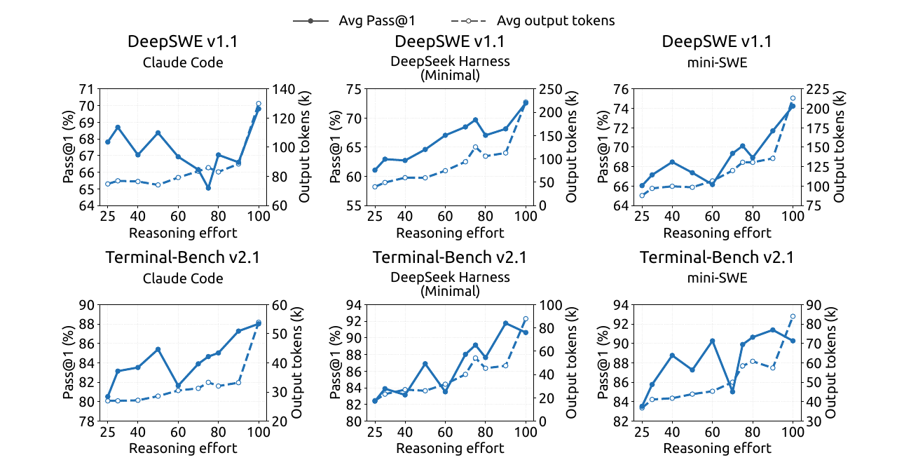

**그림 11.** 추론 노력은 궤적 길이를 일관되게 늘리지만, 코딩 스캐폴드 전반에서 정확도와의 상관은 약하다. 각 패널은 Claude Code, DeepSeek Harness Minimal, mini-SWE에서 DeepSWE v1.1(위 행) 및 Terminal-Bench v2.1(아래 행)의 노력 설정에 따른 Pass@1(%, 실선, 왼쪽 축)과 궤적당 평균 출력 토큰 수(천 단위, 파선, 오른쪽 축)를 표시한다. 모든 패널은 같은 체크포인트를 사용한다.

### B.3. 추론 노력별 추론 벤치마크 상세 결과

그림 12는 경쟁 수학·과학 질의응답·오픈 도메인 지식·코드를 포괄하는 8개 벤치마크 모두에서, 추론 노력 설정이 출력 길이와 정확도를 매끄럽고 안정적으로 제어함을 보여 준다. 길이 측면에서 노력을 25에서 100으로 올리면 모든 벤치마크의 평균 응답이 예측 가능한 방식으로 2.0~3.1배 늘어난다. AIME 2026에서는 응답당 4.6k에서 11.4k토큰, MathArena Apex 2025에서는 29.1k에서 86.1k토큰으로 증가한다. 폭주나 이상 현상이 없어 각 등급의 연산 비용을 미리 추정할 수 있다.

정확도도 비슷하게 매끄럽게 변하고 모든 벤치마크에서 바람직한 방향으로 반응한다. 노력이 증가하면서 성능이 나빠지는 벤치마크는 없다. MathArena Apex 2025는 40.3%p(25.3%→65.6%), Apex 2025 Shortlist는 11.5%p 향상된다. 이미 포화된 GPQA Diamond(+1.3%p)와 LiveCodeBench(+2.6%p)도 안정적이며, AIME 2026은 100%에 도달한다. 따라서 모델은 비용-정확도 동작점을 제어 가능하고 예측 가능한 방식으로 옮기는 하나의 신뢰할 만한 조절 수단을 제공한다. 각 배포 환경은 정확도를 해치지 않으면서 지연 및 연산 예산에 맞는 노력 등급을 선택할 수 있다.

*원문 50쪽*

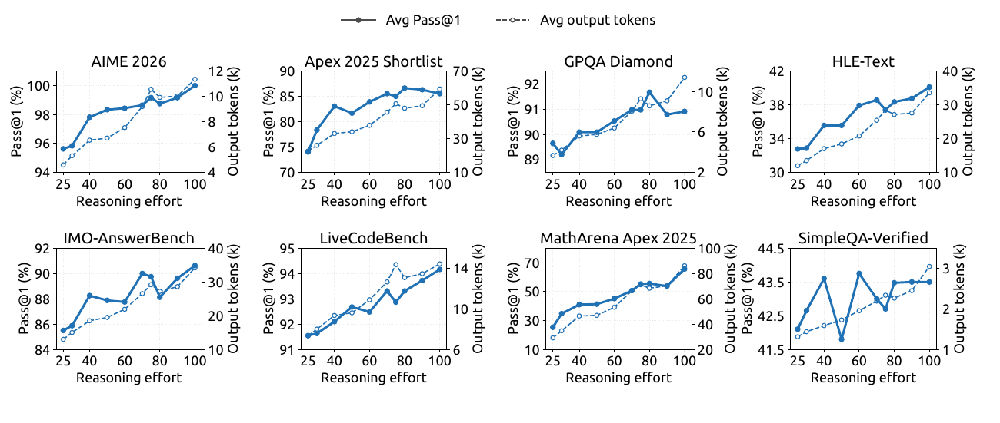

**그림 12.** 추론 집약적 벤치마크 8개에서 추론 노력에 따른 성능과 출력 길이. 노력 값을 25~100으로 바꾸면서 각 패널에 Pass@1(실선, 왼쪽 축)과 응답당 평균 출력 토큰 수(파선, 오른쪽 축)를 표시한다. HLE-Text는 HLE의 텍스트 전용 평가를 뜻한다.

## 부록 C. 추론 노력 제어의 지수형 토큰 페널티

*원문 49-51쪽*

스칼라 노력 변수는 엄격한 토큰 상한을 강제하지 않으면서 배포 시 비용-품질 절충을 제어한다. 강화학습에서 낮은 노력 수준은 더 강한 토큰 페널티를 적용하고, 높은 수준은 더 많은 연산을 허용한다. 이 절은 지수형 페널티 일정의 동기를 단순화하여 설명한다.

노력 수준 b에서 추론 토큰 ℓ개를 생성한 궤적의 길이 감점은 다음과 같다.

$$r^{len}(\ell,b)=-\min\left\{C_{max},k(b)\frac{\ell}{L_{norm}}\right\}.\qquad(11)$$

L_norm은 기준 길이, C_max는 감점 상한이다. 노력에 따른 토큰 페널티 계수는 다음과 같다.

$$k(b)=k_0\exp\left(-\frac{b-b_{min}}{\tau}\right).\qquad(12)$$

k₀는 최저 노력 수준 b_min에서의 페널티 계수이며, τ는 페널티 감소 속도를 조절한다.

이 선택의 동기를 살펴보기 위해 고정된 문제 x를 생각하자. p_x(ℓ)는 추론 토큰 ℓ개 이후 이 문제를 풀 확률이다. 감점 상한에 도달하지 않은 영역에서 선호 추론 길이 ℓ*_x(b)를 다음처럼 정의한다.

$$\ell_x^*(b)\in\underset{\ell\geq0}{\arg\max}\left[p_x(\ell)-k(b)\frac{\ell}{L_{norm}}\right].\qquad(13)$$

내부 최적점의 일차 조건은 다음과 같다.

$$p_x'\left(\ell_x^*(b)\right)=\frac{k(b)}{L_{norm}}.\qquad(14)$$

p′_x(ℓ)=dp_x(ℓ)/dℓ는 추론을 더 할 때 풀이 성공 확률이 한계적으로 얼마나 개선되는지를 나타낸다.

관련 동작 범위에서 이 한계 이득이 대략 지수적으로 감소한다고 가정한다.

$$p_x'(\ell)\approx a_x\exp\left(-\frac{\ell}{s_x}\right).\qquad(15)$$

a_x > 0은 문제별 스케일, s_x > 0은 감소 속도를 결정한다. 식 (12)와 (15)를 식 (14)에 대입하면 다음을 얻는다.

$$\ell_x^*(b)\approx C_x-s_x\log k_0+\frac{s_x}{\tau}(b-b_{min}).\qquad(16)$$

C_x=s_x log(a_x L_norm)은 b와 무관하다. 따라서 이 국소 모델에서 지수형 페널티 일정은 요청 노력과 선호 추론 길이 사이에 단순한 일차 아핀 경향을 만든다.

두 노력 수준 b₂ > b₁의 예측 길이 차이는 다음과 같다.

$$\ell_x^*(b_2)-\ell_x^*(b_1)\approx\frac{s_x}{\tau}(b_2-b_1).\qquad(17)$$

그러므로 k₀는 주로 짧은 추론을 유도하는 전체 압력을, τ는 노력에 대한 예측 민감도를 제어한다.

이 유도는 보상 수준의 국소 근사이며, 측정된 평균 길이가 반드시 선형이거나 각 지점에서 단조적이어야 한다는 주장이 아니다. 실제 행동은 다를 수 있다. 노력 지시가 추론 전략 자체를 바꿀 수 있고, 생성은 확률적이며, 에이전트 궤적은 턴 수가 서로 다르고, 하위 그룹 보상 정규화는 최적화 강도를 바꾸기 때문이다. 또한 이 분석은 감점 상한이 활성화되지 않은 내부 해를 가정한다. 상한에 도달하면 한계 토큰 페널티는 0이 되므로, 상한이 적용되는 영역은 별도로 고려해야 한다.
